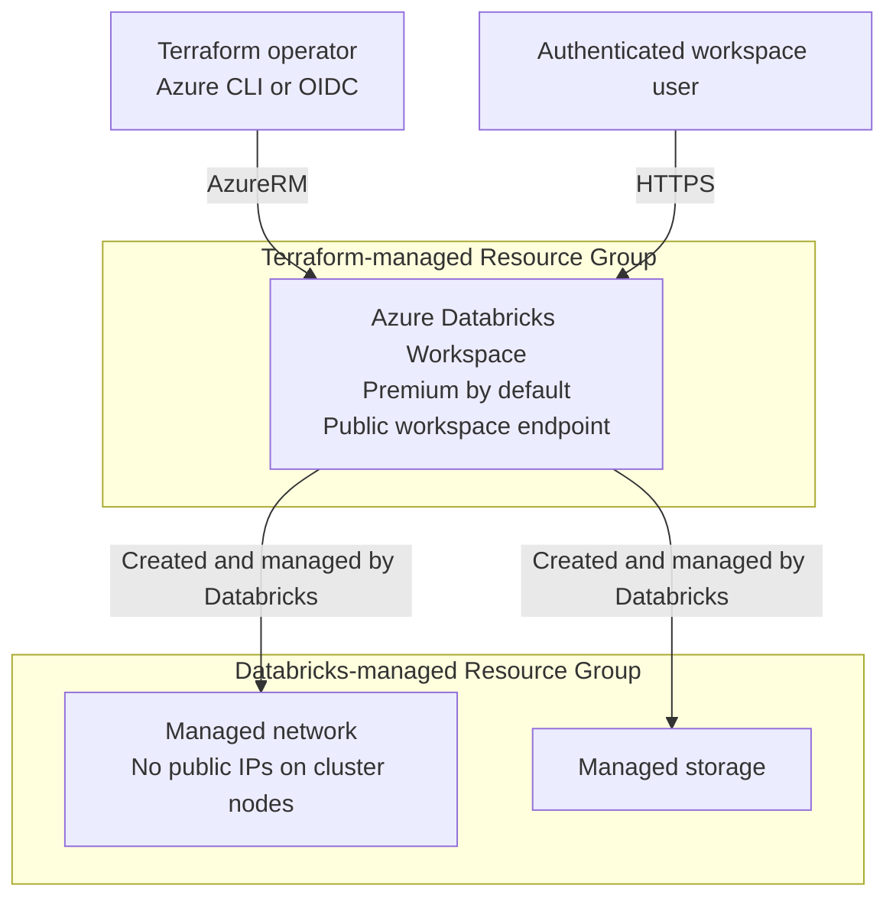

# Azure Databricks Workspace シナリオ

Resource Group と Azure Databricks Workspace を作成します。既定の SKU は `premium`、
リージョンは `japaneast` です。

既存の [random_string](../../modules/common/random_string/)、
[resource_group](../../modules/azure/resource_group/) と、再利用可能な
[databricks_workspace](../../modules/azure/databricks_workspace/) モジュールを組み合わせます。

## 対象範囲とネットワーク

- Workspace の公開エンドポイントを有効にしますが、アクセスには認証が必要です。
- `custom_parameters.no_public_ip = true` により、クラスターノードの Public IP を無効にします。
  Databricks の管理ネットワークにある NAT Gateway の Public IP まで禁止する設定ではありません。
- Databricks が別の Managed Resource Group を作成し、その中のネットワークとストレージを管理します。
  このシナリオでは名前を指定しますが、内部のリソースを個別の Terraform リソースとして管理しません。
- クラスター、Notebook、SQL Warehouse、Databricks データプレーンの権限、VNet injection、
  Private Endpoint、カスタマー マネージド暗号化キーは作成しません。

これは評価用のシナリオであり、閉域の本番構成ではありません。クラスターを作成しなくても、
管理ネットワーク・ストレージや、後から Workspace 内に作成した計算リソースには費用が発生し得ます。
Managed Resource Group 名の変更には Workspace の再作成が必要です。

## 前提条件

[プロバイダー認証](../../../docs/tips/provider-authentication.ja.md)、
[Terraform ワークフロー](../../../docs/tips/terraform-workflow.ja.md)、
任意の [Azure Blob リモート state](../../../docs/tips/azure-blob-backend.ja.md) は共通ガイドを参照してください。

デプロイ主体には Resource Group と Workspace の作成権限が必要です
（例: 適切なサブスクリプション スコープの Contributor）。
Resource Provider の登録にはサブスクリプション レベルの登録権限も必要です。
このシナリオでは `Microsoft.Databricks`、`Microsoft.Network`、`Microsoft.Resources`、
`Microsoft.Storage` を明示的に登録します。Databricks provider や Databricks token は不要です。

## アーキテクチャ



## 入力

| 変数 | 既定値 | 説明 |
| --- | --- | --- |
| `name` | `azuredatabricks` | 3-32 文字の小文字英字・数字・ハイフン。先頭と末尾は英字または数字。 |
| `location` | `japaneast` | Azure リージョン。 |
| `sku` | `premium` | `standard`、`premium`、`trial`。Trial の利用可否は Azure Databricks の適用条件に依存します。 |
| `tags` | scenario・owner タグと `SecurityControl=Ignore`、`CostControl=Ignore` | Resource Group と Workspace に適用するタグ。 |

`name` に 8 文字の小文字英数字のランダムサフィックスを付加します。
作成する名前は `rg-<name>-<suffix>`、`dbw-<name>-<suffix>`、
`rg-<name>-<suffix>-managed` です。

再利用可能なモジュールには既存の `resource_group_name` と、
省略可能な `managed_resource_group_name` も渡せます。後者を省略すると Azure が名前を生成します。
モジュールは Workspace の識別子に加え、リージョン、SKU、タグも出力します。

## 出力

| 出力 | 説明 |
| --- | --- |
| `resource_group_id`、`resource_group_name` | Terraform で管理する Resource Group の ID と名前。 |
| `workspace_resource_id`、`workspace_name` | Workspace の Azure Resource Manager ID と名前。 |
| `workspace_id` | Databricks コントロールプレーンの Workspace ID。Azure Resource Manager ID とは異なります。 |
| `workspace_url` | `adb-<workspace-id>.<number>.azuredatabricks.net` 形式のホスト名。スキームは含みません。 |
| `databricks_host` | ブラウザーで開ける `https://<workspace_url>/` 形式の URL。 |
| `managed_resource_group_id`、`managed_resource_group_name` | Databricks が管理する Resource Group の ID と名前。 |

## 使用方法

共通の認証手順を実施した後、リポジトリルートから実行します。

```shell
make init SCENARIO=azure_databricks_workspace
make lint plan SCENARIO=azure_databricks_workspace
```

リージョンと SKU を変更する例です。

```shell
terraform -chdir=infra/scenarios/azure_databricks_workspace plan \
  -var='name=analytics' \
  -var='location=westeurope' \
  -var='sku=standard'
```

plan を確認した後、同じ値で apply します。

```shell
terraform -chdir=infra/scenarios/azure_databricks_workspace apply \
  -var='name=analytics' \
  -var='location=westeurope' \
  -var='sku=standard'
terraform -chdir=infra/scenarios/azure_databricks_workspace output -raw databricks_host
```

出力された HTTPS URL を開き、認証して Workspace を確認します。
計算リソースの作成や実行は、このシナリオの対象外の別操作です。
削除は共通の Terraform ワークフローに従い、同じ変数値を指定してください。

デプロイ後に AI/BI ダッシュボードのメタデータを参照する場合は、`workspace_url` を
別の [Databricks playground シナリオ](../databricks_playground/README.ja.md)に渡してください。
Azure CLI 認証と Databricks provider を使用し、この Workspace やリソースは変更しません。

## テストと CI

Mock plan テストでは `override_during = plan` を使用するため、
Terraform **1.9 以上**が必要です。Azure の認証情報は不要で、Azure リソースは作成しません。

```shell
terraform -chdir=infra/scenarios/azure_databricks_workspace init -backend=false -lockfile=readonly -input=false
terraform -chdir=infra/scenarios/azure_databricks_workspace validate
terraform -chdir=infra/scenarios/azure_databricks_workspace test

terraform -chdir=infra/modules/azure/databricks_workspace init -backend=false -input=false
terraform -chdir=infra/modules/azure/databricks_workspace validate
terraform -chdir=infra/modules/azure/databricks_workspace test
```

既定値、入力変更、名前の長さの境界値、SKU 検証、Workspace の公開アクセスとノードの Public IP 無効化、
Managed Resource Group、接続先 URL の正確な出力をテストします。

既存の [test workflow](../../../.github/workflows/test.yml) の `test-azure` にシナリオを追加しています。
シナリオの fmt・validate・mock テストと実 AzureRM の plan を実行し、
続いてモジュールの fmt・validate・mock テストを実行します。
`dev` environment と既存の `ARM_CLIENT_ID`、`ARM_SUBSCRIPTION_ID`、`ARM_TENANT_ID`、
`ARM_USE_OIDC` secrets を再利用します。これらのテストで apply・destroy は実行しません。

実 plan のための provider 初期化で Resource Provider が登録される場合があります。
CI 実行主体に登録権限を付与するか、管理者が事前登録してください。
Mock テストや plan の成功は、Azure へのデプロイ成功や Workspace への実アクセスを保証しません。
Azure Policy、リージョンでの可用性、デプロイ権限は実環境での検証が必要です。

## 参考資料

- [Terraform を使用してワークスペースをデプロイする](https://learn.microsoft.com/ja-jp/azure/databricks/dev-tools/terraform/azure-workspace)
- [AzureRM azurerm_databricks_workspace](https://registry.terraform.io/providers/hashicorp/azurerm/latest/docs/resources/databricks_workspace)

Learn の例とは異なり、リポジトリの AzureRM 5.x・random 3.x の制約に合わせ、
リソース定義とシナリオの組み立てを分離しています。Azure の Workspace インフラだけを管理するため、
external による Azure CLI ユーザー取得、未使用の client_config、Databricks provider は省略しています。
