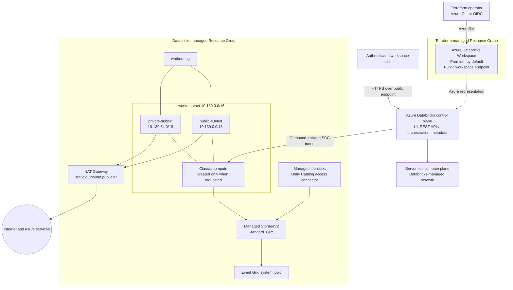

# Azure Databricks Workspace シナリオ

Resource Group と Azure Databricks Workspace を作成します。既定の SKU は `premium`、
リージョンは `japaneast` です。

既存の [random_string](../../modules/common/random_string/)、
[resource_group](../../modules/azure/resource_group/) と、再利用可能な
[databricks_workspace](../../modules/azure/databricks_workspace/) モジュールを組み合わせます。

## 対象範囲とネットワーク

- Workspace の公開エンドポイントを有効にしますが、アクセスには認証が必要です。
- `custom_parameters.no_public_ip = true` により、クラスターノードの Public IP を無効にします。
  Databricks の管理ネットワークにある NAT Gateway の Public IP まで禁止する設定ではありません。
- Databricks が別の Managed Resource Group を作成し、その中のネットワークとストレージを管理します。
  このシナリオでは名前を指定しますが、内部のリソースを個別の Terraform リソースとして管理しません。
- クラスター、Notebook、SQL Warehouse、Databricks データプレーンの権限、VNet injection、
  Private Endpoint、カスタマー マネージド暗号化キーは作成しません。

これは評価用のシナリオであり、閉域の本番構成ではありません。クラスターを作成しなくても、
管理ネットワーク・ストレージや、後から Workspace 内に作成した計算リソースには費用が発生し得ます。
Managed Resource Group 名の変更には Workspace の再作成が必要です。

## 前提条件

[プロバイダー認証](../../../docs/tips/provider-authentication.ja.md)、
[Terraform ワークフロー](../../../docs/tips/terraform-workflow.ja.md)、
任意の [Azure Blob リモート state](../../../docs/tips/azure-blob-backend.ja.md) は共通ガイドを参照してください。

デプロイ主体には Resource Group と Workspace の作成権限が必要です
（例: 適切なサブスクリプション スコープの Contributor）。
Resource Provider の登録にはサブスクリプション レベルの登録権限も必要です。
このシナリオでは `Microsoft.Databricks`、`Microsoft.Network`、`Microsoft.Resources`、
`Microsoft.Storage` を明示的に登録します。Databricks provider や Databricks token は不要です。

## アーキテクチャ



## Tips: デプロイ済み Workspace の読み解き方

以下は **2026 年 10 月 12 日**時点で Azure Resource Graph から確認した
`rg-azuredatabricks-qukyi868` と `rg-azuredatabricks-qukyi868-managed` の
スナップショットです。Terraform ファイルは再現可能な意図を示し、この節は実環境の状態を示します。
Managed Resource Group は Databricks が所有するため、サービスの更新やワークロードの起動・停止に伴って
内容が変わる可能性があります。内部リソースを直接変更または削除しないでください。

### リソースの責任分界と現在のインベントリ

| Resource Group | リソース | 確認した設定と役割 |
| --- | --- | --- |
| `rg-azuredatabricks-qukyi868` | `dbw-azuredatabricks-qukyi868` (`Microsoft.Databricks/workspaces`) | Japan East、Premium、プロビジョニング成功。Workspace の公開アクセスは有効で、`enableNoPublicIp=true`。カスタム VNet や顧客管理サブネット ID は未設定。 |
| `rg-azuredatabricks-qukyi868-managed` | `workers-vnet` | Databricks 管理の `10.139.0.0/16` VNet。`public-subnet` と `private-subnet` を含む。顧客管理 VNet injection ではなく Managed VNet。 |
| 同上 | `workers-sg` | 両サブネットで共有する NSG。明示的に確認できたルールは `VirtualNetwork` 内の Databricks worker 間通信を許可するもの。Azure の既定 NSG ルールも適用される。 |
| 同上 | `nat-gateway`、`nat-gw-public-ip` | StandardV2 NAT Gateway と静的 StandardV2 Public IP。両サブネットが共有する送信経路で、NAT アイドルタイムアウトは 20 分。 |
| 同上 | `dbstorageoksynho4zipme` | Standard_GRS StorageV2。HTTPS のみ、最小 TLS 1.2、Blob 公開アクセス無効、Microsoft 管理キー暗号化。ネットワーク ACL の既定動作は `Allow` で、共有キーアクセスは有効。 |
| 同上 | `dbmanagedidentity` | Databricks が作成したユーザー割り当て Managed Identity。サービス管理インフラとして扱う。 |
| 同上 | `unity-catalog-access-connector` | システム割り当て Managed Identity を持つ Access Connector。Azure ID の境界は提供するが、存在するだけで Catalog、Storage Credential、External Location の設定完了を意味しない。ARM Workspace の `defaultCatalog` は未設定。 |
| 同上 | Storage 名を含む Event Grid System Topic | ソースが管理 Storage Account の System Topic。この Terraform が定義したワークロードパイプラインではなく、サービス管理の補助インフラ。 |

確認時点では、VM、NIC、Managed Disk、Private Endpoint、Route Table、
カスタマー マネージド キーのリソースはどちらの Resource Group にもありませんでした。
したがって、起動中の Classic Cluster や Workspace への閉域受信経路は確認できません。
Serverless Compute は Databricks 管理の Serverless Compute Plane で実行されるため、
これらの Resource Group に VM として現れないのが通常です。

### ワークロードパターン

Workspace はプラットフォームの境界であり、この Terraform シナリオは Databricks の
Compute やデータオブジェクトを作成しません。代表的な後続ワークロードは次のとおりです。

| ワークロード | 適した Compute と処理 | このデプロイが現在提供するもの |
| --- | --- | --- |
| 対話型データエンジニアリング、探索、ML Notebook | 利用可能なら Serverless Notebook Compute、または Classic の Standard/Dedicated Compute。Classic VM は必要な間だけ Managed VNet に作成される。 | Workspace と Managed Network の基盤のみ。起動中の Classic Compute は未確認。 |
| 定期 ETL/ELT、Lakeflow Jobs | Serverless Jobs または一時的な Classic Job Compute。Raw データを読み、変換して Curated Delta Table へ書き込む。 | Job や Pipeline はこのシナリオでは作成しない。 |
| SQL 分析、Dashboard、JDBC/ODBC、BI | リージョンとアカウント機能が対応する場合は Serverless SQL Warehouse を推奨。Classic SQL Warehouse も選択肢。 | Warehouse は未作成。Azure Resource Graph では Serverless Compute Plane のインスタンスを棚卸しできない。 |
| メダリオン Lakehouse | Bronze の取り込み、Silver の検証・標準化、Gold の提供層。Unity Catalog の Managed/External Table と Volume を優先する。 | 別の playground で 3 Schema と Notebook を追加できるが、この Workspace シナリオは Catalog や本番 Data Lake を設定しない。 |

管理 Storage Account はサービスインフラです。Databricks は本番データ用途の DBFS root を非推奨とし、
データ種別に応じて Unity Catalog Volume、External Location、Workspace Files を推奨しています。
管理 Storage Account を汎用 Data Lake として使わず、本番データには顧客管理 ADLS Gen2 と
最小権限の Access Connector ロール割り当てを使用してください。

### ネットワークとセキュリティ上の意味

- **ユーザー受信:** Workspace UI と API は公開 HTTPS Endpoint から到達可能ですが、
  Databricks の認証と認可が必要です。この構成には Front-end Private Endpoint がありません。
- **Classic Compute:** Secure Cluster Connectivity (`no_public_ip`) により Cluster Node に Public IP を
  付与せず、Control Plane への接続を送信方向から開始します。`public-subnet` という名前は、
  その Node が Public IP を持つという意味ではありません。
- **送信:** 2 つの `/18` Subnet は同じ NAT Gateway を使用します。安定した送信元アドレスは得られますが、
  宛先のフィルタリング機能ではありません。検査、許可リスト、Private Data Source 接続が必要な場合は、
  顧客管理 VNet、UDR、Azure Firewall/NVA、または Databricks Network Connectivity Configuration を検討します。
- **データアクセス:** 管理 Storage Account は現在、ネットワークアクセスを既定で許可し、
  共有キー認証も有効です。本番 Dataset では Managed Identity、Unity Catalog ガバナンス、
  必要に応じた Private Endpoint、独立した Storage Lifecycle と RBAC 境界を優先します。
- **可用性とコスト:** Standard_GRS は管理 Storage をリージョン間で保護しますが、Compute の可用性は
  選択したモードと設定に依存します。NAT Gateway、Public IP、Storage、Serverless 利用量、
  後から作成する Classic Compute は、シナリオ自体が Cluster を作らなくても課金対象になり得ます。

## 入力

| 変数 | 既定値 | 説明 |
| --- | --- | --- |
| `name` | `azuredatabricks` | 3-32 文字の小文字英字・数字・ハイフン。先頭と末尾は英字または数字。 |
| `location` | `japaneast` | Azure リージョン。 |
| `sku` | `premium` | `standard`、`premium`、`trial`。Trial の利用可否は Azure Databricks の適用条件に依存します。 |
| `tags` | scenario・owner タグと `SecurityControl=Ignore`、`CostControl=Ignore` | Resource Group と Workspace に適用するタグ。 |

`name` に 8 文字の小文字英数字のランダムサフィックスを付加します。
作成する名前は `rg-<name>-<suffix>`、`dbw-<name>-<suffix>`、
`rg-<name>-<suffix>-managed` です。

再利用可能なモジュールには既存の `resource_group_name` と、
省略可能な `managed_resource_group_name` も渡せます。後者を省略すると Azure が名前を生成します。
モジュールは Workspace の識別子に加え、リージョン、SKU、タグも出力します。

## 出力

| 出力 | 説明 |
| --- | --- |
| `resource_group_id`、`resource_group_name` | Terraform で管理する Resource Group の ID と名前。 |
| `workspace_resource_id`、`workspace_name` | Workspace の Azure Resource Manager ID と名前。 |
| `workspace_id` | Databricks コントロールプレーンの Workspace ID。Azure Resource Manager ID とは異なります。 |
| `workspace_url` | `adb-<workspace-id>.<number>.azuredatabricks.net` 形式のホスト名。スキームは含みません。 |
| `databricks_host` | ブラウザーで開ける `https://<workspace_url>/` 形式の URL。 |
| `managed_resource_group_id`、`managed_resource_group_name` | Databricks が管理する Resource Group の ID と名前。 |

## 使用方法

共通の認証手順を実施した後、リポジトリルートから実行します。

```shell
make init SCENARIO=azure_databricks_workspace
make lint plan SCENARIO=azure_databricks_workspace
```

リージョンと SKU を変更する例です。

```shell
terraform -chdir=infra/scenarios/azure_databricks_workspace plan \
  -var='name=analytics' \
  -var='location=westeurope' \
  -var='sku=standard'
```

plan を確認した後、同じ値で apply します。

```shell
terraform -chdir=infra/scenarios/azure_databricks_workspace apply \
  -var='name=analytics' \
  -var='location=westeurope' \
  -var='sku=standard'
terraform -chdir=infra/scenarios/azure_databricks_workspace output -raw databricks_host
```

出力された HTTPS URL を開き、認証して Workspace を確認します。
計算リソースの作成や実行は、このシナリオの対象外の別操作です。
削除は共通の Terraform ワークフローに従い、同じ変数値を指定してください。

デプロイ後に AI/BI ダッシュボードの参照やモックデータによるメダリオンハンズオンを追加する場合は、`workspace_url` を
別の [Databricks playground シナリオ](../databricks_playground/README.ja.md)に渡してください。
Azure CLI 認証と Databricks provider を使用します。任意で既存の Unity Catalog カタログ名を指定すると、
Serverless compute を使う専用スキーマ 3 個と SQL Notebook を追加します。
ハンズオンのオブジェクトは別 state で管理し、この Azure Workspace 自体は管理しません。
Unity Catalog、管理テーブル用ストレージ、Serverless の利用可否はリンク先の前提条件を満たす必要があり、
この Azure 構成ではそれらを設定しません。

## テストと CI

Mock plan テストでは `override_during = plan` を使用するため、
Terraform **1.9 以上**が必要です。Azure の認証情報は不要で、Azure リソースは作成しません。

```shell
terraform -chdir=infra/scenarios/azure_databricks_workspace init -backend=false -lockfile=readonly -input=false
terraform -chdir=infra/scenarios/azure_databricks_workspace validate
terraform -chdir=infra/scenarios/azure_databricks_workspace test

terraform -chdir=infra/modules/azure/databricks_workspace init -backend=false -input=false
terraform -chdir=infra/modules/azure/databricks_workspace validate
terraform -chdir=infra/modules/azure/databricks_workspace test
```

既定値、入力変更、名前の長さの境界値、SKU 検証、Workspace の公開アクセスとノードの Public IP 無効化、
Managed Resource Group、接続先 URL の正確な出力をテストします。

既存の [test workflow](../../../.github/workflows/test.yml) の `test-azure` にシナリオを追加しています。
シナリオの fmt・validate・mock テストと実 AzureRM の plan を実行し、
続いてモジュールの fmt・validate・mock テストを実行します。
`dev` environment と既存の `ARM_CLIENT_ID`、`ARM_SUBSCRIPTION_ID`、`ARM_TENANT_ID`、
`ARM_USE_OIDC` secrets を再利用します。これらのテストで apply・destroy は実行しません。

実 plan のための provider 初期化で Resource Provider が登録される場合があります。
CI 実行主体に登録権限を付与するか、管理者が事前登録してください。
Mock テストや plan の成功は、Azure へのデプロイ成功や Workspace への実アクセスを保証しません。
Azure Policy、リージョンでの可用性、デプロイ権限は実環境での検証が必要です。

## 参考資料

- [Terraform を使用してワークスペースをデプロイする](https://learn.microsoft.com/ja-jp/azure/databricks/dev-tools/terraform/azure-workspace)
- [Azure Databricks の上位アーキテクチャ](https://learn.microsoft.com/ja-jp/azure/databricks/getting-started/high-level-architecture)
- [Azure Databricks のネットワーク](https://learn.microsoft.com/ja-jp/azure/databricks/security/network/)
- [Secure Cluster Connectivity](https://learn.microsoft.com/ja-jp/azure/databricks/security/network/classic/secure-cluster-connectivity)
- [顧客管理 VNet injection](https://learn.microsoft.com/ja-jp/azure/databricks/security/network/classic/vnet-inject)
- [Azure Databricks の Compute 種別](https://learn.microsoft.com/ja-jp/azure/databricks/compute/)
- [SQL Warehouse](https://learn.microsoft.com/ja-jp/azure/databricks/compute/sql-warehouse/)
- [Unity Catalog Storage での Azure Managed Identity](https://learn.microsoft.com/ja-jp/azure/databricks/connect/unity-catalog/cloud-storage/azure-managed-identities)
- [DBFS root の場所と現在の推奨事項](https://learn.microsoft.com/ja-jp/azure/databricks/dbfs/root-locations)
- [AzureRM azurerm_databricks_workspace](https://registry.terraform.io/providers/hashicorp/azurerm/latest/docs/resources/databricks_workspace)

Learn の例とは異なり、リポジトリの AzureRM 5.x・random 3.x の制約に合わせ、
リソース定義とシナリオの組み立てを分離しています。Azure の Workspace インフラだけを管理するため、
external による Azure CLI ユーザー取得、未使用の client_config、Databricks provider は省略しています。
