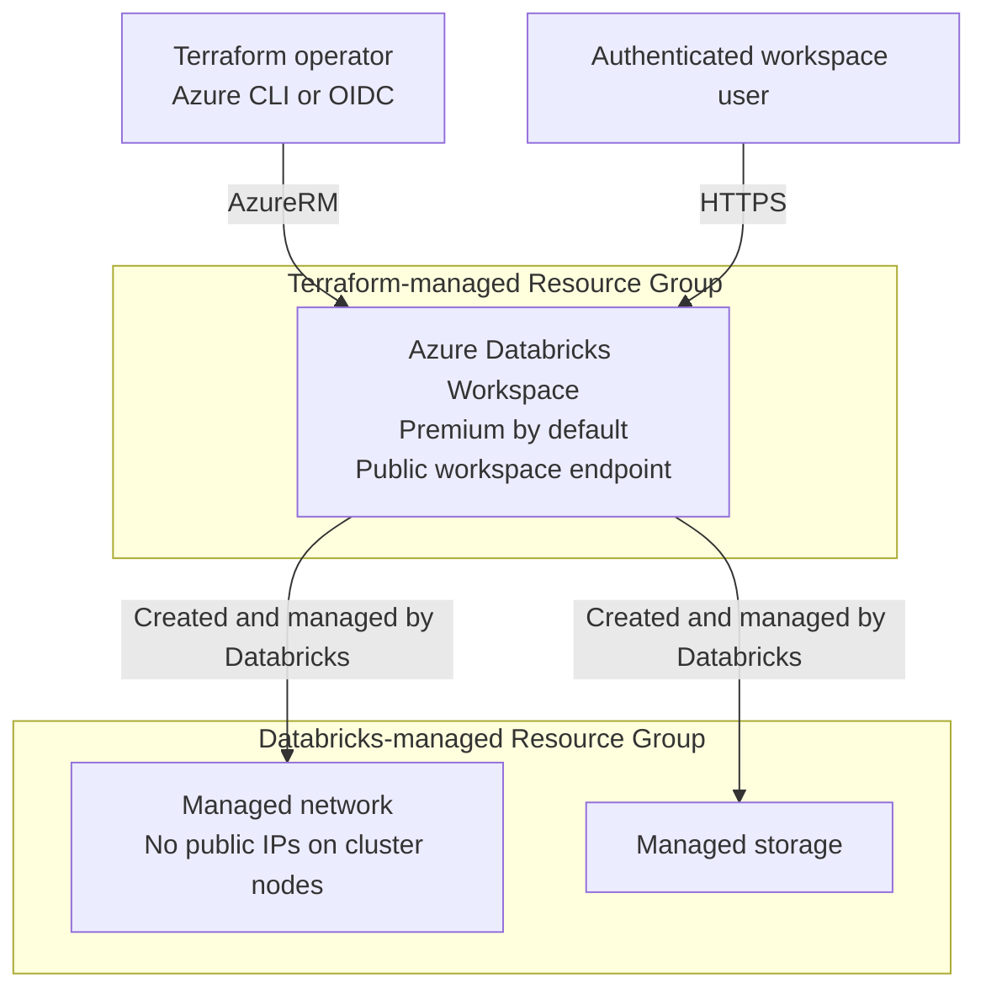

# Azure Databricks Workspace Scenario

Create a Resource Group and Azure Databricks Workspace. The default SKU is `premium`
and the default region is `japaneast`.

The scenario composes the existing [random_string](../../modules/common/random_string/)
and [resource_group](../../modules/azure/resource_group/) modules with the reusable
[databricks_workspace](../../modules/azure/databricks_workspace/) module.

## Scope and networking

- The workspace endpoint is publicly reachable but still requires authentication.
- `custom_parameters.no_public_ip = true` prevents public IPs on cluster nodes.
  It does not prohibit the NAT gateway's public IP in the Databricks-managed network.
- Databricks creates and owns a separate Managed Resource Group containing managed
  networking and storage. This scenario names it but does not manage its contents
  as separate Terraform resources.
- Clusters, notebooks, SQL warehouses, Databricks data-plane permissions, VNet
  injection, Private Endpoints, and customer-managed encryption keys are not created.

This is an evaluation scenario, not a private-network production configuration.
Managed networking/storage and any compute subsequently created in the workspace
can incur charges even though this scenario does not create a cluster.
Changing the Managed Resource Group name requires workspace replacement.

## Prerequisites

Follow the shared guides for [provider authentication](../../../docs/tips/provider-authentication.md),
the [Terraform workflow](../../../docs/tips/terraform-workflow.md), and optional
[Azure Blob remote state](../../../docs/tips/azure-blob-backend.md).

The deployment identity needs permission to create the Resource Group and workspace
(for example, Contributor at the appropriate subscription scope). Provider registration
also needs subscription-level registration permission. The scenario explicitly registers
`Microsoft.Databricks`, `Microsoft.Network`, `Microsoft.Resources`, and `Microsoft.Storage`.
No Databricks provider or Databricks token is required.

## Architecture



## Inputs

| Variable | Default | Description |
| --- | --- | --- |
| `name` | `azuredatabricks` | Base name: 3-32 lowercase letters, numbers, or hyphens; starts and ends with a letter or number. |
| `location` | `japaneast` | Azure region. |
| `sku` | `premium` | `standard`, `premium`, or `trial`. Trial availability is subject to Azure Databricks eligibility. |
| `tags` | Scenario and owner tags plus `SecurityControl=Ignore`, `CostControl=Ignore` | Tags applied to the Resource Group and workspace. |

An eight-character lowercase alphanumeric random suffix is appended to `name`.
The resulting names are `rg-<name>-<suffix>`, `dbw-<name>-<suffix>`, and
`rg-<name>-<suffix>-managed`.

The reusable module also accepts an existing `resource_group_name` and an optional
`managed_resource_group_name`. Omitting the latter lets Azure generate the name.
The module exposes location, SKU, and tags as well as the workspace identifiers.

## Outputs

| Output | Description |
| --- | --- |
| `resource_group_id`, `resource_group_name` | ID and name of the Terraform-managed Resource Group. |
| `workspace_resource_id`, `workspace_name` | Azure Resource Manager ID and name of the workspace. |
| `workspace_id` | Databricks control-plane workspace ID, not the Azure Resource Manager ID. |
| `workspace_url` | Hostname such as `adb-<workspace-id>.<number>.azuredatabricks.net`, without a scheme. |
| `databricks_host` | `https://<workspace_url>/`, ready to open in a browser. |
| `managed_resource_group_id`, `managed_resource_group_name` | ID and name of the Databricks-managed Resource Group. |

## How to use

Run from the repository root after completing the shared authentication steps:

```shell
make init SCENARIO=azure_databricks_workspace
make lint plan SCENARIO=azure_databricks_workspace
```

To choose a different region and SKU:

```shell
terraform -chdir=infra/scenarios/azure_databricks_workspace plan \
  -var='name=analytics' \
  -var='location=westeurope' \
  -var='sku=standard'
```

After reviewing the plan, apply the same values:

```shell
terraform -chdir=infra/scenarios/azure_databricks_workspace apply \
  -var='name=analytics' \
  -var='location=westeurope' \
  -var='sku=standard'
terraform -chdir=infra/scenarios/azure_databricks_workspace output -raw databricks_host
```

Open the returned HTTPS URL and authenticate to inspect the workspace.
Creating or running compute is a separate operation outside this scenario.
For cleanup, follow the shared Terraform workflow and use the same variable values.

To read AI/BI dashboard metadata or add a mock-data medallion hands-on, pass `workspace_url` to the
separate [Databricks playground scenario](../databricks_playground/README.md).
It uses Azure CLI authentication and the Databricks provider. An optional existing
Unity Catalog catalog enables three dedicated schemas and a SQL Notebook using
Serverless compute. That scenario manages the hands-on objects in a separate state,
not the Azure Workspace. Unity Catalog, managed-table storage, and Serverless
availability must satisfy its prerequisites; this Azure configuration does not
configure them.

## Tests and CI

Mock plan tests require Terraform **1.9 or later** because they use `override_during = plan`.
They do not require Azure credentials or create Azure resources:

```shell
terraform -chdir=infra/scenarios/azure_databricks_workspace init -backend=false -lockfile=readonly -input=false
terraform -chdir=infra/scenarios/azure_databricks_workspace validate
terraform -chdir=infra/scenarios/azure_databricks_workspace test

terraform -chdir=infra/modules/azure/databricks_workspace init -backend=false -input=false
terraform -chdir=infra/modules/azure/databricks_workspace validate
terraform -chdir=infra/modules/azure/databricks_workspace test
```

Tests cover defaults, custom inputs, name length boundaries, SKU validation, public
workspace access with no public node IPs, managed resource groups, and exact output URLs.

The existing [test workflow](../../../.github/workflows/test.yml) includes this scenario
in `test-azure`. It runs scenario fmt/validate/mock tests and a real AzureRM plan,
then runs module fmt/validate/mock tests. It reuses the `dev` environment and existing
`ARM_CLIENT_ID`, `ARM_SUBSCRIPTION_ID`, `ARM_TENANT_ID`, and `ARM_USE_OIDC` secrets.
No apply/destroy is performed by these tests.

Provider initialization for the real plan can register Resource Providers. Ensure the
CI identity has the necessary registration permissions, or have an administrator
pre-register the providers. A successful mock test or plan does not prove successful
Azure deployment or workspace access; Azure Policy, regional availability, and
deployment permissions are validated only against the real environment.

## References

- [Deploy a workspace using Terraform](https://learn.microsoft.com/azure/databricks/dev-tools/terraform/azure-workspace)
- [AzureRM azurerm_databricks_workspace](https://registry.terraform.io/providers/hashicorp/azurerm/latest/docs/resources/databricks_workspace)

Compared with the Learn example, this scenario follows the repository's AzureRM 5.x
and random 3.x constraints and separates resource definitions from scenario composition.
It omits external Azure CLI user lookup, unused client configuration, and a Databricks
provider because only Azure workspace infrastructure is managed.
