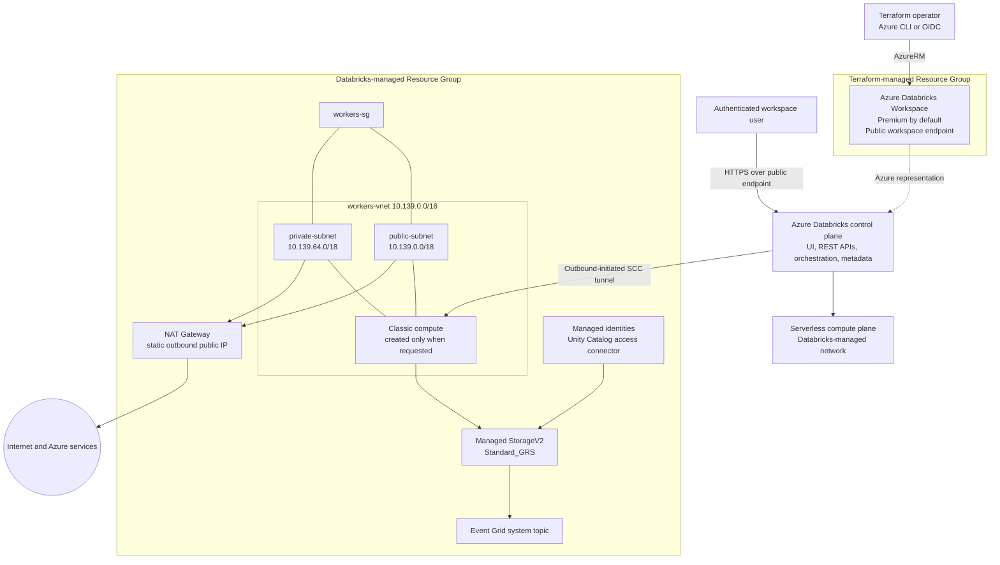

# Azure Databricks Workspace Scenario

Create a Resource Group and Azure Databricks Workspace. The default SKU is `premium`
and the default region is `japaneast`.

The scenario composes the existing [random_string](../../modules/common/random_string/)
and [resource_group](../../modules/azure/resource_group/) modules with the reusable
[databricks_workspace](../../modules/azure/databricks_workspace/) module.

## Scope and networking

- The workspace endpoint is publicly reachable but still requires authentication.
- `custom_parameters.no_public_ip = true` prevents public IPs on cluster nodes.
  It does not prohibit the NAT gateway's public IP in the Databricks-managed network.
- Databricks creates and owns a separate Managed Resource Group containing managed
  networking and storage. This scenario names it but does not manage its contents
  as separate Terraform resources.
- Clusters, notebooks, SQL warehouses, Databricks data-plane permissions, VNet
  injection, Private Endpoints, and customer-managed encryption keys are not created.

This is an evaluation scenario, not a private-network production configuration.
Managed networking/storage and any compute subsequently created in the workspace
can incur charges even though this scenario does not create a cluster.
Changing the Managed Resource Group name requires workspace replacement.

## Prerequisites

Follow the shared guides for [provider authentication](../../../docs/tips/provider-authentication.md),
the [Terraform workflow](../../../docs/tips/terraform-workflow.md), and optional
[Azure Blob remote state](../../../docs/tips/azure-blob-backend.md).

The deployment identity needs permission to create the Resource Group and workspace
(for example, Contributor at the appropriate subscription scope). Provider registration
also needs subscription-level registration permission. The scenario explicitly registers
`Microsoft.Databricks`, `Microsoft.Network`, `Microsoft.Resources`, and `Microsoft.Storage`.
No Databricks provider or Databricks token is required.

## Architecture



## Tips: interpreting the deployed workspace

The following is a point-in-time Azure Resource Graph observation of
`rg-azuredatabricks-qukyi868` and `rg-azuredatabricks-qukyi868-managed` on
**October 12, 2026**. It describes that deployment, while the Terraform files describe
the reproducible intent. Databricks owns the managed Resource Group, so its contents
can change as the service evolves or workloads start and stop. Do not modify or delete
its individual resources directly.

### Resource ownership and current inventory

| Resource Group | Resource | Observed configuration and role |
| --- | --- | --- |
| `rg-azuredatabricks-qukyi868` | `dbw-azuredatabricks-qukyi868` (`Microsoft.Databricks/workspaces`) | Japan East, Premium, provisioning succeeded. Public workspace access is enabled and `enableNoPublicIp=true`. No custom VNet or customer subnet IDs are configured. |
| `rg-azuredatabricks-qukyi868-managed` | `workers-vnet` | Databricks-managed `10.139.0.0/16` VNet with `public-subnet` and `private-subnet`. This is a managed VNet, not customer-managed VNet injection. |
| same | `workers-sg` | NSG shared by both subnets. The explicit observed rule permits Databricks worker-to-worker traffic inside `VirtualNetwork`; Azure default NSG rules also apply. |
| same | `nat-gateway`, `nat-gw-public-ip` | StandardV2 NAT Gateway and static StandardV2 public IP. Both subnets use this shared egress path; the NAT idle timeout is 20 minutes. |
| same | `dbstorageoksynho4zipme` | Standard_GRS StorageV2 account with HTTPS-only, TLS 1.2 minimum, blob public access disabled, Microsoft-managed encryption, and network ACL default action `Allow`. Shared-key access remains enabled. |
| same | `dbmanagedidentity` | Databricks-created user-assigned managed identity. Treat it as service-managed infrastructure. |
| same | `unity-catalog-access-connector` | Access Connector with a system-assigned managed identity. Its presence supplies an Azure identity boundary, but does not by itself prove that catalogs, storage credentials, or external locations are configured. The ARM workspace reports no `defaultCatalog`. |
| same | storage-named Event Grid system topic | System topic whose source is the managed storage account. It is supporting service-managed infrastructure, not a workload pipeline defined by this Terraform scenario. |

No VM, NIC, managed disk, private endpoint, route table, or customer-managed key
resource was present in either Resource Group at observation time. Therefore, the
inventory does **not** show a running classic cluster or a private workspace ingress
path. Serverless compute runs in a Databricks-managed serverless compute plane and
would not be expected to appear as VMs in these Resource Groups.

### Workload patterns

The Workspace is a platform boundary; this Terraform scenario does not create
Databricks compute or data objects. Typical follow-on workloads are:

| Workload | Suitable compute and flow | What this deployment currently provides |
| --- | --- | --- |
| Interactive engineering, exploration, and ML notebooks | Serverless notebook compute when available, or classic standard/dedicated compute. Classic VMs are created in the managed VNet only while needed. | Workspace and managed network foundation only; no running classic compute was observed. |
| Scheduled ETL/ELT and Lakeflow Jobs | Serverless jobs or ephemeral classic job compute. Read raw data, transform it, and write curated Delta tables. | No jobs or pipelines are created by this scenario. |
| SQL analytics, dashboards, JDBC/ODBC, and BI | Prefer a serverless SQL warehouse when region and account features permit; classic SQL warehouses are another option. | No warehouse is created here. Azure Resource Graph cannot inventory serverless compute-plane instances. |
| Medallion lakehouse | Bronze ingestion, Silver validation/conformance, and Gold serving layers, preferably as Unity Catalog managed or external tables and volumes. | The separate playground can add three schemas and a notebook, but this Workspace scenario does not configure a catalog or production data lake. |

The managed storage account is service infrastructure. Databricks now deprecates DBFS
root for production data and recommends Unity Catalog volumes, external locations, or
workspace files according to the data type. Use separate customer-managed ADLS Gen2
accounts and least-privilege Access Connector role assignments for production data
rather than treating the managed account as a general-purpose data lake.

### Network and security implications

- **User ingress:** the Workspace UI and APIs are reachable through a public HTTPS
  endpoint and still require Databricks authentication and authorization. There is no
  front-end Private Endpoint in this deployment.
- **Classic compute:** Secure Cluster Connectivity (`no_public_ip`) means cluster nodes
  do not receive public IPs and initiate the control-plane connection outbound. The
  `public-subnet` name does not mean its nodes have public IPs.
- **Egress:** both `/18` subnets attach to the same NAT Gateway. This provides a stable
  outbound address, not destination filtering. Add a customer-managed VNet, UDR, Azure
  Firewall/NVA, or Databricks network connectivity configuration when inspection,
  allow-listing, or private data-source access is required.
- **Data access:** the managed storage account currently allows network access by
  default and permits shared-key authentication. For production datasets, prefer
  managed identity, Unity Catalog governance, private endpoints where required, and
  separate storage lifecycle and RBAC boundaries.
- **Availability and cost:** Standard_GRS protects the managed storage across regions,
  while compute availability depends on the selected compute mode and configuration.
  NAT Gateway, public IP, storage, serverless usage, and any later classic compute can
  all incur charges even when this Terraform scenario itself creates no cluster.

## Inputs

| Variable | Default | Description |
| --- | --- | --- |
| `name` | `azuredatabricks` | Base name: 3-32 lowercase letters, numbers, or hyphens; starts and ends with a letter or number. |
| `location` | `japaneast` | Azure region. |
| `sku` | `premium` | `standard`, `premium`, or `trial`. Trial availability is subject to Azure Databricks eligibility. |
| `tags` | Scenario and owner tags plus `SecurityControl=Ignore`, `CostControl=Ignore` | Tags applied to the Resource Group and workspace. |

An eight-character lowercase alphanumeric random suffix is appended to `name`.
The resulting names are `rg-<name>-<suffix>`, `dbw-<name>-<suffix>`, and
`rg-<name>-<suffix>-managed`.

The reusable module also accepts an existing `resource_group_name` and an optional
`managed_resource_group_name`. Omitting the latter lets Azure generate the name.
The module exposes location, SKU, and tags as well as the workspace identifiers.

## Outputs

| Output | Description |
| --- | --- |
| `resource_group_id`, `resource_group_name` | ID and name of the Terraform-managed Resource Group. |
| `workspace_resource_id`, `workspace_name` | Azure Resource Manager ID and name of the workspace. |
| `workspace_id` | Databricks control-plane workspace ID, not the Azure Resource Manager ID. |
| `workspace_url` | Hostname such as `adb-<workspace-id>.<number>.azuredatabricks.net`, without a scheme. |
| `databricks_host` | `https://<workspace_url>/`, ready to open in a browser. |
| `managed_resource_group_id`, `managed_resource_group_name` | ID and name of the Databricks-managed Resource Group. |

## How to use

Run from the repository root after completing the shared authentication steps:

```shell
make init SCENARIO=azure_databricks_workspace
make lint plan SCENARIO=azure_databricks_workspace
```

To choose a different region and SKU:

```shell
terraform -chdir=infra/scenarios/azure_databricks_workspace plan \
  -var='name=analytics' \
  -var='location=westeurope' \
  -var='sku=standard'
```

After reviewing the plan, apply the same values:

```shell
terraform -chdir=infra/scenarios/azure_databricks_workspace apply \
  -var='name=analytics' \
  -var='location=westeurope' \
  -var='sku=standard'
terraform -chdir=infra/scenarios/azure_databricks_workspace output -raw databricks_host
```

Open the returned HTTPS URL and authenticate to inspect the workspace.
Creating or running compute is a separate operation outside this scenario.
For cleanup, follow the shared Terraform workflow and use the same variable values.

To read AI/BI dashboard metadata or add a mock-data medallion hands-on, pass `workspace_url` to the
separate [Databricks playground scenario](../databricks_playground/README.md).
It uses Azure CLI authentication and the Databricks provider. An optional existing
Unity Catalog catalog enables three dedicated schemas and a SQL Notebook using
Serverless compute. That scenario manages the hands-on objects in a separate state,
not the Azure Workspace. Unity Catalog, managed-table storage, and Serverless
availability must satisfy its prerequisites; this Azure configuration does not
configure them.

## Tests and CI

Mock plan tests require Terraform **1.9 or later** because they use `override_during = plan`.
They do not require Azure credentials or create Azure resources:

```shell
terraform -chdir=infra/scenarios/azure_databricks_workspace init -backend=false -lockfile=readonly -input=false
terraform -chdir=infra/scenarios/azure_databricks_workspace validate
terraform -chdir=infra/scenarios/azure_databricks_workspace test

terraform -chdir=infra/modules/azure/databricks_workspace init -backend=false -input=false
terraform -chdir=infra/modules/azure/databricks_workspace validate
terraform -chdir=infra/modules/azure/databricks_workspace test
```

Tests cover defaults, custom inputs, name length boundaries, SKU validation, public
workspace access with no public node IPs, managed resource groups, and exact output URLs.

The existing [test workflow](../../../.github/workflows/test.yml) includes this scenario
in `test-azure`. It runs scenario fmt/validate/mock tests and a real AzureRM plan,
then runs module fmt/validate/mock tests. It reuses the `dev` environment and existing
`ARM_CLIENT_ID`, `ARM_SUBSCRIPTION_ID`, `ARM_TENANT_ID`, and `ARM_USE_OIDC` secrets.
No apply/destroy is performed by these tests.

Provider initialization for the real plan can register Resource Providers. Ensure the
CI identity has the necessary registration permissions, or have an administrator
pre-register the providers. A successful mock test or plan does not prove successful
Azure deployment or workspace access; Azure Policy, regional availability, and
deployment permissions are validated only against the real environment.

## References

- [Deploy a workspace using Terraform](https://learn.microsoft.com/azure/databricks/dev-tools/terraform/azure-workspace)
- [High-level Azure Databricks architecture](https://learn.microsoft.com/azure/databricks/getting-started/high-level-architecture)
- [Azure Databricks networking](https://learn.microsoft.com/azure/databricks/security/network/)
- [Secure Cluster Connectivity](https://learn.microsoft.com/azure/databricks/security/network/classic/secure-cluster-connectivity)
- [Customer-managed VNet injection](https://learn.microsoft.com/azure/databricks/security/network/classic/vnet-inject)
- [Azure Databricks compute types](https://learn.microsoft.com/azure/databricks/compute/)
- [SQL warehouses](https://learn.microsoft.com/azure/databricks/compute/sql-warehouse/)
- [Azure managed identities for Unity Catalog storage](https://learn.microsoft.com/azure/databricks/connect/unity-catalog/cloud-storage/azure-managed-identities)
- [DBFS root locations and current recommendations](https://learn.microsoft.com/azure/databricks/dbfs/root-locations)
- [AzureRM azurerm_databricks_workspace](https://registry.terraform.io/providers/hashicorp/azurerm/latest/docs/resources/databricks_workspace)

Compared with the Learn example, this scenario follows the repository's AzureRM 5.x
and random 3.x constraints and separates resource definitions from scenario composition.
It omits external Azure CLI user lookup, unused client configuration, and a Databricks
provider because only Azure workspace infrastructure is managed.
