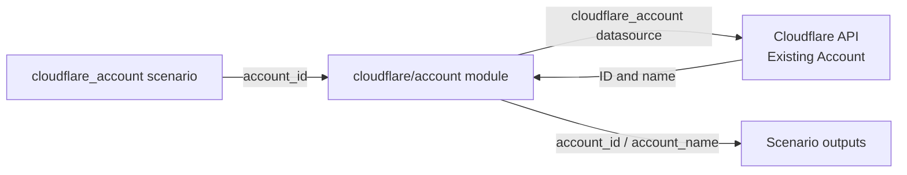

# Cloudflare Account

Read an existing Cloudflare account by its Account ID and expose its ID and name.
This scenario does not create, modify, or delete Cloudflare resources.
It is an authentication and account-lookup example, not an account-provisioning
or DNS-management example. No domain or Zone ID is required.

## Architecture



The [account module](../../modules/cloudflare/account/) owns the datasource.
Its required input is `account_id`, and its outputs are `id` and `name`.
Provider configuration and output naming belong to the scenario.
The module fails the plan if the datasource ID does not match its requested ID.

## Prerequisites

- Complete the prerequisites in the [Terraform workflow](../../../docs/tips/terraform-workflow.md).
- Use Terraform 1.11 or later. `terraform init` also parses the included tests,
  whose `override_during = plan` syntax requires that version.
- Obtain an existing Account ID: exactly 32 lowercase hexadecimal characters.
- Configure [Cloudflare provider authentication](../../../docs/tips/provider-authentication.md#cloudflare)
  with an API Token limited to the target account and `Account Settings: Read`.

## How to use

### 1. Find the Account ID in the portal

1. Sign in to the [Cloudflare dashboard](https://dash.cloudflare.com/) and select
   the target account.
2. Click **Search**, or press **Cmd + K** on macOS / **Ctrl + K** on Windows.
3. Enter **`Copy account ID`** and select the result to copy the ID.

You can also copy the ID from **Workers & Pages → Account Details → Account ID**.
If you have a domain, open its **Overview** page and find **Account ID** in the
**API** section near the bottom.
Use the **Account ID**, not the **Zone ID**.
See the [official instructions](https://developers.cloudflare.com/fundamentals/account/find-account-and-zone-ids/).

### 2. Set the Account ID

Create `infra/scenarios/cloudflare_account/terraform.tfvars` in your editor if it
does not exist. If it already exists, update only `account_id`; do not overwrite
other local settings. Replace the placeholder below with the ID copied from the portal:

```hcl
account_id = "<your-32-character-account-id>"
```

`023e105f4ecef8ad9ca31a8372d0c353`, used in examples and mock tests, is a dummy ID,
not your Account ID. Replace it before running a real API plan.
Terraform automatically loads `terraform.tfvars` from the scenario directory.
The file is ignored by Git; keep `CLOUDFLARE_API_TOKEN` in the environment, not in it.

Alternatively, when `account_id` is not set in a variable file, run from the
repository root:

```bash
export TF_VAR_account_id="<your-32-character-account-id>"
```

Variable files take precedence over `TF_VAR_account_id`. An old or dummy ID in
`terraform.tfvars` will override an ID exported in the environment.

### 3. Configure authentication and optional state storage

Follow the [Cloudflare authentication steps](../../../docs/tips/provider-authentication.md#cloudflare)
to create a read-only API Token and export `CLOUDFLARE_API_TOKEN` in the same
terminal where you will run Terraform. Do not paste the token into chat or
write it into Terraform files.

Without a backend block, the scenario uses Terraform's local backend.
If you have added a local `backend.tf` for Azure Blob Storage, configure
[Azure backend authentication and permissions](../../../docs/tips/azure-blob-backend.md)
before initialization. Cloudflare authentication and Azure state storage
authentication are separate; a Cloudflare API Token cannot authenticate the Azure backend.
Keep the environment-specific `backend.tf` out of Git.

### 4. Run a read-only plan

Run from the repository root:

```bash
make init SCENARIO=cloudflare_account
make lint SCENARIO=cloudflare_account
make plan SCENARIO=cloudflare_account
```

Only Cloudflare API authentication is required unless you configure a separate
remote backend. Azure CLI and Azure permissions are not required for local state.

The plan reads the real Cloudflare API and shows the account outputs without
changing Cloudflare resources. Authentication or lookup failures fail the plan;
they are not replaced with empty outputs.
Confirm that `account_id` matches the ID you copied and that `account_name` is
the intended account's name. No Cloudflare resource creation, update, or deletion
should be planned.
Apply is not required for this check. `make output` reads outputs already saved
in state; it does not show new outputs from an unapplied plan.
Saved plans and state can contain additional datasource attributes, such as account
settings and contact details, even though only ID and name are exposed as outputs.
Treat these artifacts as confidential.
See the [Terraform workflow](../../../docs/tips/terraform-workflow.md) for shared operations.

### Troubleshooting

| Symptom | Check |
|---------|-------|
| Account ID validation fails | Use exactly 32 lowercase hexadecimal characters, without spaces; do not use a Zone ID or an example value. |
| The plan uses a different Account ID | Check `account_id` in `terraform.tfvars` and other variable files; these override `TF_VAR_account_id`. |
| Token missing or authentication fails | Export `CLOUDFLARE_API_TOKEN` in the same terminal. Do not print its value to diagnose the issue. |
| Provider reports conflicting authentication options | Unset legacy `CLOUDFLARE_API_KEY`, `CLOUDFLARE_EMAIL`, and `CLOUDFLARE_API_USER_SERVICE_KEY` before using API Token authentication. |
| Cloudflare reports an authorization or lookup error | Check the Account ID, token expiry, `Account Settings: Read`, and that the token's account scope matches the requested account. |
| Initialization fails against Azure Storage | Check the local `backend.tf`, Azure CLI authentication, and Blob data-plane permissions using the backend guide. This is separate from Cloudflare authentication. |
| Mock tests pass but the real plan fails | Mock tests do not verify a real Account ID, token, permissions, or Cloudflare connectivity. Run the real API plan after configuring them. |

## Variables

| Name | Type | Description | Default |
|------|------|-------------|---------|
| `account_id` | `string` | Existing Cloudflare Account ID; exactly 32 lowercase hexadecimal characters, non-null | (required) |

## Outputs

| Name | Description |
|------|-------------|
| `account_id` | Account ID returned by the datasource |
| `account_name` | Account name returned by the datasource |

## Offline tests

The module and scenario tests use a mock Cloudflare provider and `command = plan`.
They do not require credentials, call the Cloudflare API, or run apply.
Provider installation still requires network access.
The tests require Terraform 1.11 or later; prefer the version used in
[CI](../../../.github/workflows/test.yml).
The reusable module retains Terraform 1.6 compatibility when used as a dependency,
but initializing it directly with its included tests also requires Terraform 1.11.

Run from the repository root; the tests supply their own Account IDs.
For the scenario, use a fresh temporary Terraform data directory so tests do not
reuse local backend settings, and disable backend initialization:

```bash
(
  set -e
  test_data=$(mktemp -d)
  trap 'find "$test_data" -depth -delete' EXIT

  export TF_DATA_DIR="$test_data/scenario"
  terraform -chdir=infra/scenarios/cloudflare_account init -backend=false -lockfile=readonly -input=false
  terraform -chdir=infra/scenarios/cloudflare_account fmt -check
  terraform -chdir=infra/scenarios/cloudflare_account validate
  terraform -chdir=infra/scenarios/cloudflare_account test

  export TF_DATA_DIR="$test_data/module"
  terraform -chdir=infra/modules/cloudflare/account init -backend=false -input=false
  terraform -chdir=infra/modules/cloudflare/account fmt -check
  terraform -chdir=infra/modules/cloudflare/account validate
  terraform -chdir=infra/modules/cloudflare/account test
)
```

The subshell stops on the first failure and cleans up only its temporary Terraform
data directory. Module initialization may create a local `.terraform.lock.hcl`;
the module's broader provider constraint can select a newer 5.x release than the
scenario's lock file.
Tests cover ID/name outputs, selection of another account, rejection of a
mismatched datasource ID, and rejection of empty, short, long, non-hexadecimal,
uppercase, and whitespace-padded Account IDs.
Neither format validation nor mocks can distinguish a Zone ID from an Account ID
with the same format; the real API plan checks the selected account.

## CI

The Cloudflare jobs in [test.yml](../../../.github/workflows/test.yml) separate
mock validation from real API access:

- `test-cloudflare-mock`: initializes with `-backend=false`, checks formatting,
  validates, and runs the scenario and module mock tests. No Cloudflare Secrets or
  GitHub Environment `dev` approval are needed.
- `test-cloudflare`: runs after the mock job, uses GitHub Environment `dev`, and
  runs `make init lint plan` against the real API. Credentials are exposed only to
  the credential-check and plan step. It does not run apply or destroy.

Configure these environment Secrets before running the real API job:

| Secret | Purpose |
|--------|---------|
| `CLOUDFLARE_API_TOKEN` | API Token with `Account Settings: Read` for the target account |
| `CLOUDFLARE_ACCOUNT_ID` | Account ID passed as `TF_VAR_account_id` |

The real API job fails explicitly if either Secret is missing; it is not silently
skipped. The mock job remains independent of those credentials.
Cloudflare uses API Token authentication here, not OIDC.

## References

- [Cloudflare Account datasource (v5.27.0)](https://registry.terraform.io/providers/cloudflare/cloudflare/5.27.0/docs/data-sources/account)
- [Cloudflare API Tokens](https://developers.cloudflare.com/fundamentals/api/get-started/create-token/)
- [Terraform 1.11 release notes (`override_during`)](https://github.com/hashicorp/terraform/blob/v1.11.0/CHANGELOG.md)
