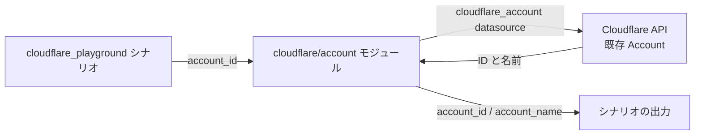

# Cloudflare Playground

Account ID を指定して既存の Cloudflare Account を参照し、ID と名前を公開します。
このシナリオは Cloudflare リソースの作成・変更・削除を行いません。
認証と Account 参照の例であり、Account の新規作成や DNS 管理の例ではありません。
ドメインや Zone ID は不要です。

## アーキテクチャ



datasource は [account モジュール](../../modules/cloudflare/account/)に定義されています。
モジュールの必須入力は `account_id`、出力は `id` と `name` です。
プロバイダー設定とシナリオでの出力名はシナリオ側で管理します。
datasource の ID が要求した ID と一致しない場合、モジュールは plan を失敗させます。

## 前提条件

- [Terraform ワークフロー](../../../docs/tips/terraform-workflow.ja.md)の前提条件を満たします。
- Terraform 1.11 以降を使用します。`terraform init` は同梱されたテストも解析するため、
  `override_during = plan` の構文が利用できるこのバージョンが必要です。
- 既存の Account ID を取得します。小文字の 16 進数 32 文字である必要があります。
- 対象 Account の `Account Settings: Read` に限定した API Token を使用して、
  [Cloudflare プロバイダー認証](../../../docs/tips/provider-authentication.ja.md#cloudflare)を設定します。

## 使用方法

### 1. ポータルで Account ID を確認する

1. [Cloudflare ダッシュボード](https://dash.cloudflare.com/)にログインし、対象 Account を選択します。
2. **Search** をクリックするか、macOS では **Cmd + K**、Windows では **Ctrl + K** を押します。
3. **`Copy account ID`** と入力し、検索結果を選択すると ID がコピーされます。

**Workers & Pages → Account Details → Account ID** からもコピーできます。
ドメインがある場合は、対象ドメインの **Overview** ページ下部にある
**API** セクションの **Account ID** でも確認できます。
**Zone ID ではなく Account ID** を使用してください。
[公式手順](https://developers.cloudflare.com/fundamentals/account/find-account-and-zone-ids/)も参照できます。

### 2. Account ID を設定する

`infra/scenarios/cloudflare_playground/terraform.tfvars` がなければエディターで作成します。
すでにある場合は、他のローカル設定を上書きせず `account_id` だけを更新してください。
次のプレースホルダーをポータルからコピーした ID に置き換えます。

```hcl
account_id = "<your-32-character-account-id>"
```

サンプルや mock テストで使用している `023e105f4ecef8ad9ca31a8372d0c353` は
ダミー ID であり、利用者の Account ID ではありません。実 API の plan の前に置き換えてください。
Terraform はシナリオのディレクトリから `terraform.tfvars` を自動で読み込みます。
このファイルは Git 管理外です。`CLOUDFLARE_API_TOKEN` はファイルではなく環境変数で渡します。

変数ファイルに `account_id` を設定しない場合は、代わりにリポジトリのルートで
次を実行できます。

```bash
export TF_VAR_account_id="<your-32-character-account-id>"
```

変数ファイルは `TF_VAR_account_id` よりも優先されます。`terraform.tfvars` に
古い ID やダミー ID が残っていると、環境変数に設定した ID よりも優先されます。

### 3. 認証と任意の state 保存先を設定する

[Cloudflare の認証手順](../../../docs/tips/provider-authentication.ja.md#cloudflare)に従って
読み取り専用の API Token を作成し、Terraform を実行するのと同じターミナルで
`CLOUDFLARE_API_TOKEN` をエクスポートしてください。
トークンをチャットに貼り付けたり、Terraform ファイルに記入したりしないでください。

backend ブロックがない場合は Terraform のローカル backend を使用します。
Azure Blob Storage 用のローカル `backend.tf` を追加している場合は、初期化前に
[Azure backend の認証と権限](../../../docs/tips/azure-blob-backend.ja.md)を設定してください。
Cloudflare の認証と Azure の state 保存先の認証は別であり、
Cloudflare API Token では Azure backend に認証できません。
環境固有の `backend.tf` は Git 管理外にしてください。

シナリオのディレクトリ名変更後に既存のチェックアウトを更新する場合は、
Git 管理外のローカルファイル（`backend.tf`、変数ファイル、`.terraform/`、
ローカル state、保存済み plan）も `infra/scenarios/cloudflare_playground/` へ移動します。
同じ state を引き続き使用するため、state の key を含む既存の backend 設定は変更しないでください。
Terraform のモジュール・datasource のアドレス、入力、出力、認証用の名前は変更していないため、
この改名に伴う Terraform state の移行は不要です。

### 4. 読み取り専用の plan を実行する

リポジトリのルートで実行します。

```bash
make init SCENARIO=cloudflare_playground
make lint SCENARIO=cloudflare_playground
make plan SCENARIO=cloudflare_playground
```

別のリモート backend を設定しない限り、認証は Cloudflare API 用だけで十分です。
ローカル state を使用する場合、Azure CLI や Azure の権限は不要です。

plan は実際の Cloudflare API を参照し、Cloudflare リソースを変更せずに Account の出力を表示します。
認証や参照に失敗した場合は plan が失敗し、空の出力には置き換えません。
`account_id` がコピーした ID と一致し、`account_name` が対象 Account の名前であることを確認します。
Cloudflare リソースの作成・変更・削除が計画されていないことも確認してください。
この確認に apply は不要です。`make output` は state に保存済みの出力を読むため、
apply していない plan の新しい出力は表示しません。
公開する出力が ID と名前だけでも、保存した plan や state には Account の設定や
連絡先など、datasource の追加属性が含まれる場合があります。これらの成果物は機密情報として扱ってください。
共通の操作は [Terraform ワークフロー](../../../docs/tips/terraform-workflow.ja.md)を参照してください。

### トラブルシューティング

| 症状 | 確認事項 |
|------|----------|
| Account ID の形式検証に失敗する | 空白を含まない小文字の 16 進数 32 文字を指定します。Zone ID やサンプル値を使用しないでください。 |
| plan が別の Account ID を使用する | `terraform.tfvars` や他の変数ファイルの `account_id` を確認します。これらは `TF_VAR_account_id` よりも優先されます。 |
| Token 未設定、または認証に失敗する | 同じターミナルで `CLOUDFLARE_API_TOKEN` をエクスポートします。調査のために値を表示しないでください。 |
| プロバイダーが認証オプションの競合を報告する | API Token 認証の前に、旧来の `CLOUDFLARE_API_KEY`、`CLOUDFLARE_EMAIL`、`CLOUDFLARE_API_USER_SERVICE_KEY` を解除します。 |
| Cloudflare の権限・参照エラーが発生する | Account ID、Token の有効期限、`Account Settings: Read`、Token の対象 Account と指定 Account の一致を確認します。 |
| Azure Storage に対する初期化が失敗する | backend ガイドに従ってローカルの `backend.tf`、Azure CLI 認証、Blob のデータプレーン権限を確認します。Cloudflare 認証とは別です。 |
| mock テストは成功するが実際の plan は失敗する | mock テストは実際の Account ID、Token、権限、Cloudflare への接続を検証しません。設定後に実 API の plan を実行します。 |

## 変数

| 名前 | 型 | 説明 | 既定値 |
|------|------|------|--------|
| `account_id` | `string` | 既存の Cloudflare Account ID。小文字の 16 進数 32 文字で、null 不可 | (必須) |

## 出力

| 名前 | 説明 |
|------|------|
| `account_id` | datasource が返した Account ID |
| `account_name` | datasource が返した Account 名 |

## オフラインテスト

モジュールとシナリオのテストは mock Cloudflare provider と `command = plan` を使用します。
資格情報は不要で、Cloudflare API の呼び出しや apply は行いません。
プロバイダーのインストールにはネットワーク接続が必要です。
テストには Terraform 1.11 以降が必要です。[CI](../../../.github/workflows/test.yml)と
同じバージョンの使用を推奨します。
再利用モジュールを依存先として使う場合の Terraform 1.6 互換性は維持しますが、
同梱テストを含むモジュールを直接初期化する場合も Terraform 1.11 が必要です。

リポジトリのルートで実行します。テスト用の Account ID はテスト内で設定されます。
シナリオのテストでは、新しい一時 Terraform データディレクトリを使用して
ローカルの backend 設定を再利用せず、backend の初期化を無効にします。

```bash
(
  set -e
  test_data=$(mktemp -d)
  trap 'find "$test_data" -depth -delete' EXIT

  export TF_DATA_DIR="$test_data/scenario"
  terraform -chdir=infra/scenarios/cloudflare_playground init -backend=false -lockfile=readonly -input=false
  terraform -chdir=infra/scenarios/cloudflare_playground fmt -check
  terraform -chdir=infra/scenarios/cloudflare_playground validate
  terraform -chdir=infra/scenarios/cloudflare_playground test

  export TF_DATA_DIR="$test_data/module"
  terraform -chdir=infra/modules/cloudflare/account init -backend=false -input=false
  terraform -chdir=infra/modules/cloudflare/account fmt -check
  terraform -chdir=infra/modules/cloudflare/account validate
  terraform -chdir=infra/modules/cloudflare/account test
)
```

このサブシェルは最初の失敗で停止し、自身が作成した一時 Terraform データディレクトリだけを削除します。
モジュールの初期化では、ローカルの `.terraform.lock.hcl` が作成される場合があります。
モジュールの provider 制約は広いため、シナリオの lock ファイルより新しい 5.x が選択される場合があります。
ID・名前の出力、別 Account の選択、datasource の ID 不一致の拒否、
空文字・短すぎる ID・長すぎる ID・16 進数以外・大文字・前後の空白を含む ID の拒否を検証します。
形式検証や mock では、同じ形式の Zone ID と Account ID を区別できません。
実 API の plan で対象 Account を確認してください。

## CI

[test.yml](../../../.github/workflows/test.yml) の Cloudflare job は、
mock の検証と実 API へのアクセスを分離しています。

- `test-cloudflare-mock`: `-backend=false` で初期化し、書式チェック、validate、
  シナリオとモジュールの mock テストを実行します。Cloudflare Secrets や
  GitHub Environment `dev` の承認は不要です。
- `test-cloudflare`: mock job の成功後に GitHub Environment `dev` を使用し、
  `make init lint plan` で実 API を参照します。資格情報は資格情報チェックと plan の
  step にだけ渡します。apply / destroy は行いません。

実 API の job の実行前に、次の Environment Secrets を設定してください。

| Secret | 用途 |
|--------|------|
| `CLOUDFLARE_API_TOKEN` | 対象 Account の `Account Settings: Read` 権限を持つ API Token |
| `CLOUDFLARE_ACCOUNT_ID` | `TF_VAR_account_id` に渡す Account ID |

どちらかの Secret が未設定の場合、実 API の job は明示的に失敗し、黙ってスキップしません。
mock job はこれらの資格情報に依存しません。
Cloudflare の認証には OIDC ではなく API Token を使用します。

## 参考資料

- [Cloudflare Account datasource (v5.27.0)](https://registry.terraform.io/providers/cloudflare/cloudflare/5.27.0/docs/data-sources/account)
- [Cloudflare API Tokens](https://developers.cloudflare.com/fundamentals/api/get-started/create-token/)
- [Terraform 1.11 リリースノート（`override_during`）](https://github.com/hashicorp/terraform/blob/v1.11.0/CHANGELOG.md)
