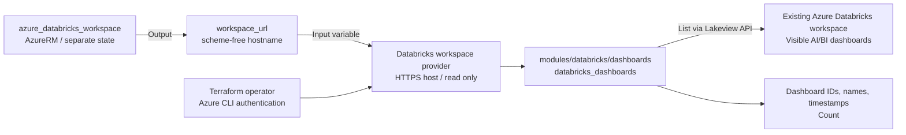

# Databricks Dashboards シナリオ

`databricks/databricks` provider と Azure CLI 認証で、既存の Azure Databricks
Workspace に接続します。再利用可能な
[dashboards モジュール](../../modules/databricks/dashboards/)で
`databricks_dashboards` を参照し、メタデータの一覧と件数を公開します。

## 対象範囲

- 認証主体に見える AI/BI（Lakeview）ダッシュボードを参照します。
  表示名の大文字小文字を区別しない部分一致フィルターを任意指定できます。
- `dashboard_id`、`display_name`、`create_time` のみを出力し、ダッシュボードの内容は公開しません。
  Workspace にダッシュボードがない場合や該当なしの場合は `[]` と件数 `0` を返します。
  認証・疎通・権限エラーは provider のエラーとして扱います。
- Workspace、ダッシュボード、権限、クラスター、Notebook、SQL Warehouse の作成・更新・削除は行いません。
  旧 SQL ダッシュボードは対象外です。
- Workspace の作成とこの参照は別の Terraform 構成・state で管理します。
  このシナリオにリモート state への依存や AzureRM provider はありません。

## 前提条件

[プロバイダー認証](../../../docs/tips/provider-authentication.ja.md#databricks)、
[Terraform ワークフロー](../../../docs/tips/terraform-workflow.ja.md)、
任意の [Azure Blob backend](../../../docs/tips/azure-blob-backend.ja.md) は共通ガイドを参照してください。

- 通常の構成には Terraform **1.6 以上**、native mock テストには **1.9 以上**が必要です。
- Azure CLI を導入し、Workspace のテナントで認証してください。
  Provider は `auth_type = "azure-cli"` を明示します。PAT と Databricks CLI は不要です。
- [azure_databricks_workspace](../azure_databricks_workspace/README.ja.md)などで作成済みの
  Workspace が必要です。実行主体には Workspace の利用権限と、ダッシュボードの閲覧権限が必要です。
  Azure RBAC だけではこれらの Databricks データプレーン権限は付与されません。
- Workspace エンドポイントへの HTTPS 接続が必要です。
  AI/BI ダッシュボードは手動または別構成で準備できますが、存在しなくてもシナリオは成功します。
  一覧取得のために計算リソースを起動しません。

## アーキテクチャ



## 入力

| 変数 | 既定値 | 説明 |
| --- | --- | --- |
| `workspace_url` | 必須 | `adb-1234567890123456.7.azuredatabricks.net` などの Workspace DNS ホスト名。スキーム・パス・ポート・空白を含めず、全体で 253 文字以内、各 DNS ラベルは 63 文字以内。 |
| `dashboard_name_contains` | `null` | ダッシュボード表示名の大文字小文字を区別しない部分一致。省略・`null`・`""` は見えるダッシュボードを全件取得。 |

Provider は `https://<workspace_url>` を構成します。Workspace 作成シナリオの
`workspace_url` 出力を渡し、HTTPS URL の **`databricks_host` 出力は渡さない**でください。
モジュールは呼び出し元の provider を継承し、Workspace の接続・認証設定は
シナリオの `providers.tf` に置きます。

## 出力

| 出力 | 説明 |
| --- | --- |
| `databricks_host` | Workspace provider の接続先 URL `https://<workspace_url>`。 |
| `dashboards` | `dashboard_id`、`display_name`、`create_time` を持つオブジェクトの一覧。作成日時は欠落値も含めて provider の返す値を保持。 |
| `dashboard_count` | 任意のフィルターに一致し、認証主体に見えるダッシュボードの件数。管理者視点の全件数ではない。 |

## 使用方法

共通の Azure CLI 認証手順を実施した後、リポジトリルートから Bash で実行します。
Workspace 作成シナリオは apply 済みで、その state にアクセスできる必要があります。

```shell
set -e
TF_VAR_workspace_url="$(terraform -chdir=infra/scenarios/azure_databricks_workspace output -raw workspace_url)"
export TF_VAR_workspace_url
make init SCENARIO=databricks_dashboards
make lint plan SCENARIO=databricks_dashboards
```

代入と `export` を分けることで、出力取得の失敗が `export` に隠されることを防ぎます。
別の構成で作成した Workspace では、そのスキームなしホスト名を `TF_VAR_workspace_url` に設定してください。
シナリオ間で Terraform state はコピーしません。

表示名で絞り込む例です。

```shell
terraform -chdir=infra/scenarios/databricks_dashboards plan \
  -var='dashboard_name_contains=sales'
```

plan の出力に表示される一覧を確認します。plan は API を参照しますが、
`terraform output` 用の出力は保存しません。上の絞り込み結果をこのシナリオの
state に保存する場合は、同じ入力で明示的に apply します。

```shell
terraform -chdir=infra/scenarios/databricks_dashboards apply \
  -var='dashboard_name_contains=sales'
terraform -chdir=infra/scenarios/databricks_dashboards output -json dashboards
terraform -chdir=infra/scenarios/databricks_dashboards output -raw dashboard_count
```

この構成に管理対象リソースはありません。apply は参照結果と出力を state に記録し、
Databricks オブジェクトを作成・変更しません。Workspace のメタデータを含むため、
state と保存済みの plan を保護してください。結果の更新には plan/apply を再実行します。
`terraform output` だけでは Databricks を再参照しません。

## テストと CI

Native mock plan テストには Terraform **1.9 以上**が必要です。
認証は不要で、空一覧、フィルター引数の伝達、正確な HTTPS host、
不正なホスト名の拒否を確認します。

```shell
terraform -chdir=infra/scenarios/databricks_dashboards init -backend=false -lockfile=readonly -input=false
terraform -chdir=infra/scenarios/databricks_dashboards fmt -check -recursive
terraform -chdir=infra/scenarios/databricks_dashboards validate
terraform -chdir=infra/scenarios/databricks_dashboards test

terraform -chdir=infra/modules/databricks/dashboards init -backend=false -input=false
terraform -chdir=infra/modules/databricks/dashboards fmt -check -recursive
terraform -chdir=infra/modules/databricks/dashboards validate
terraform -chdir=infra/modules/databricks/dashboards test
```

Terraform の [nested attribute の mock 制限](https://github.com/hashicorp/terraform/issues/38369)により、
このデータソースの Plugin Framework スキーマには、空でない一覧 fixture を渡せません。
そのため追加テストでは、最新版 provider を維持したまま、
**実 provider をローカルの静的 API fixture に接続**します。
大文字小文字を区別しない実際のフィルター処理、複数件、作成日時の欠落、
メタデータだけの出力形状、フィルター後の空一覧を検証します。

```shell
sh infra/modules/databricks/dashboards/tests/test_fixture_api.sh
```

この runner には Python 3 と curl も必要です。Python 標準ライブラリの HTTP server を
`127.0.0.1` の一時ポートで起動し、ダミーのテストトークン、
独立した一時 `TF_DATA_DIR`、plan のみのテストを使用します。
終了時に server を停止し、一時データを削除します。
Fixture テストは既定のテストディレクトリ外に配置し、この runner でのみ選択します。
ダミートークンは実際の資格情報ではなく、Azure Workspace に対しては使用しません。

[test workflow](../../../.github/workflows/test.yml) の `test-databricks-mock` で
native mock とローカル API fixture の両方を検証します。
Azure login、Environment の承認、Secrets、実 Workspace の API 呼び出し、
apply、destroy は使用しません。成功しても実際の Azure CLI 認証、
Workspace の疎通、権限は保証されません。これらは実 Workspace に対する手動の plan で確認してください。

## 参考資料

- [Databricks Terraform プロバイダー（Microsoft Learn）](https://learn.microsoft.com/ja-jp/azure/databricks/dev-tools/terraform/)
- [Azure CLI 認証](https://learn.microsoft.com/ja-jp/azure/databricks/dev-tools/auth/azure-cli)
- [databricks_dashboards データソース](https://registry.terraform.io/providers/databricks/databricks/latest/docs/data-sources/dashboards)

Learn の作成例とは異なり、再利用可能な Databricks モジュールでダッシュボードメタデータだけを参照します。
Notebook、クラスター、ジョブは作成しません。
