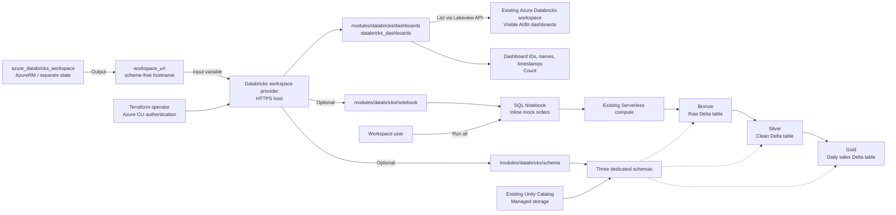

# Databricks Playground シナリオ

`databricks/databricks` provider と Azure CLI 認証で、既存の Azure Databricks
Workspace に接続します。再利用可能な
[dashboards モジュール](../../modules/databricks/dashboards/)で
`databricks_dashboards` を参照し、メタデータの一覧と件数を公開します。
任意で専用の Unity Catalog スキーマ 3 個と SQL Notebook を配置し、
固定のモック注文データで **Bronze → Silver → Gold** のハンズオンを実施できます。
Databricks リソースは再利用可能な
[schema](../../modules/databricks/schema/)・
[notebook](../../modules/databricks/notebook/) モジュールで管理します。

## 対象範囲

- 認証主体に見える AI/BI（Lakeview）ダッシュボードを参照します。
  表示名の大文字小文字を区別しない部分一致フィルターを任意指定できます。
- `dashboard_id`、`display_name`、`create_time` のみを出力し、ダッシュボードの内容は公開しません。
  Workspace にダッシュボードがない場合や該当なしの場合は `[]` と件数 `0` を返します。
  認証・疎通・権限エラーは provider のエラーとして扱います。
- `medallion_catalog_name` が未指定なら従来どおり参照のみです。
  既存カタログ名を指定すると **スキーマ 3 個と SQL Notebook 1 個**を追加します。
  Terraform は配置までを担当し、Notebook は実行しません。**Run all** で
  Notebook 内のモックデータから Delta 管理テーブル 3 個を作成します。
- Workspace、カタログ、権限、クラスター、SQL Warehouse、Job、Lakeflow パイプラインは作成しません。
  外部ストレージ・外部データソース・追加パッケージは不要です。旧 SQL ダッシュボードは対象外です。
- Workspace の作成とこのシナリオは別の Terraform 構成・state で管理します。
  このシナリオにリモート state への依存や AzureRM provider はありません。

## 前提条件

[プロバイダー認証](../../../docs/tips/provider-authentication.ja.md#databricks)、
[Terraform ワークフロー](../../../docs/tips/terraform-workflow.ja.md)、
任意の [Azure Blob backend](../../../docs/tips/azure-blob-backend.ja.md) は共通ガイドを参照してください。

- 通常の構成には Terraform **1.6 以上**、native mock テストには **1.9 以上**が必要です。
- Azure CLI を導入し、Workspace のテナントで認証してください。
  Provider は `auth_type = "azure-cli"` を明示します。PAT と Databricks CLI は不要です。
- [azure_databricks_workspace](../azure_databricks_workspace/README.ja.md)などで作成済みの
  Workspace が必要です。実行主体には Workspace の利用権限と、ダッシュボードの閲覧権限が必要です。
  Azure RBAC だけではこれらの Databricks データプレーン権限は付与されません。
- Workspace エンドポイントへの HTTPS 接続が必要です。
  AI/BI ダッシュボードは手動または別構成で準備できますが、存在しなくてもシナリオは成功します。
  一覧取得のために計算リソースを起動しません。

任意のハンズオンには、次の前提も必要です。

- Workspace で Unity Catalog と Serverless Notebook compute を利用できること。
  **Catalog Explorer** に表示される Workspace カタログなど、書き込み可能で
  管理テーブル用ストレージが設定済みの既存カタログを使います。
  Workspace URL を渡すだけでは、これらの前提は保証されません。
- Terraform の実行主体が対象カタログの `USE CATALOG`・`CREATE SCHEMA` と、
  `/Shared` 配下への Notebook 作成権限を持つこと。
  Notebook も同じ Databricks ユーザーで実行します。別の主体への共有・権限付与は対象外です。
- 未使用のスキーマプレフィックスと Notebook パスを選ぶこと。専用スキーマとその内容は
  **使い捨て**です。既存オブジェクトを再利用したり、無関係なデータを保存したりしないでください。
- Unity Catalog の初期設定、管理ストレージ設定、Serverless の有効化は行いません。
  前提が不足する場合は apply 前に解消してください。Hive metastore や新規クラスターへ自動で切り替えません。
- Serverless の実行と管理テーブルの保存には利用料金が発生し得ます。

## アーキテクチャ



## 入力

| 変数 | 既定値 | 説明 |
| --- | --- | --- |
| `workspace_url` | 必須 | `adb-1234567890123456.7.azuredatabricks.net` などの Workspace DNS ホスト名。スキーム・パス・ポート・空白を含めず、全体で 253 文字以内、各 DNS ラベルは 63 文字以内。 |
| `dashboard_name_contains` | `null` | ダッシュボード表示名の大文字小文字を区別しない部分一致。省略・`null`・`""` は見えるダッシュボードを全件取得。 |
| `medallion_catalog_name` | `null` | 管理ストレージ設定済みで書き込み可能な既存 Unity Catalog カタログ。`null` はハンズオン無効。指定時は 1-255 文字の ASCII 英数字・アンダースコア・ハイフンで、先頭のハイフンは禁止。空文字・`hive_metastore`・`system` は拒否。 |
| `medallion_schema_prefix` | `medallion_playground` | 専用スキーマと Notebook のプレフィックス。1-248 文字の ASCII 小文字英字・数字・アンダースコアで、先頭は英字。層のサフィックスを含めてスキーマ名を 255 文字以内に収める。 |

Provider は `https://<workspace_url>` を構成します。Workspace 作成シナリオの
`workspace_url` 出力を渡し、HTTPS URL の **`databricks_host` 出力は渡さない**でください。
モジュールは呼び出し元の provider を継承し、Workspace の接続・認証設定は
シナリオの `providers.tf` に置きます。

## 出力

| 出力 | 説明 |
| --- | --- |
| `databricks_host` | Workspace provider の接続先 URL `https://<workspace_url>`。 |
| `dashboards` | `dashboard_id`、`display_name`、`create_time` を持つオブジェクトの一覧。作成日時は欠落値も含めて provider の返す値を保持。 |
| `dashboard_count` | 任意のフィルターに一致し、認証主体に見えるダッシュボードの件数。管理者視点の全件数ではない。 |
| `medallion` | 無効時は `null`。有効時は `catalog_name`、`bronze` / `silver` / `gold` をキーとする `schemas`・`tables` マップ、`notebook_path`、`notebook_url` を持つオブジェクト。テーブルは Notebook 実行後に作成される。 |

## 使用方法

共通の Azure CLI 認証手順を実施した後、リポジトリルートから Bash で実行します。
Workspace 作成シナリオは apply 済みで、その state にアクセスできる必要があります。

```shell
set -e
TF_VAR_workspace_url="$(terraform -chdir=infra/scenarios/azure_databricks_workspace output -raw workspace_url)"
export TF_VAR_workspace_url
make init SCENARIO=databricks_playground
make lint plan SCENARIO=databricks_playground
```

代入と `export` を分けることで、出力取得の失敗が `export` に隠されることを防ぎます。
別の構成で作成した Workspace では、そのスキームなしホスト名を `TF_VAR_workspace_url` に設定してください。
シナリオ間で Terraform state はコピーしません。

表示名で絞り込む例です。

```shell
terraform -chdir=infra/scenarios/databricks_playground plan \
  -var='dashboard_name_contains=sales'
```

plan の出力に表示される一覧を確認します。plan は API を参照しますが、
`terraform output` 用の出力は保存しません。上の絞り込み結果をこのシナリオの
state に保存する場合は、同じ入力で明示的に apply します。

```shell
terraform -chdir=infra/scenarios/databricks_playground apply \
  -var='dashboard_name_contains=sales'
terraform -chdir=infra/scenarios/databricks_playground output -json dashboards
terraform -chdir=infra/scenarios/databricks_playground output -raw dashboard_count
```

ハンズオンが無効なら管理対象リソースはありません。apply は参照結果と出力を state に記録し、
Databricks オブジェクトを作成・変更しません。Workspace のメタデータを含むため、
state と保存済みの plan を保護してください。結果の更新には plan/apply を再実行します。
`terraform output` だけでは Databricks を再参照しません。

## メダリオンアーキテクチャハンズオン

### Terraform での配置

上記の `TF_VAR_workspace_url` を設定した後、Catalog Explorer で確認した
**実際の既存カタログ名**を指定します。次のプレースホルダーは置き換えてください。

```shell
export TF_VAR_medallion_catalog_name="your_existing_catalog"
export TF_VAR_medallion_schema_prefix="medallion_playground"
make init SCENARIO=databricks_playground
make lint plan SCENARIO=databricks_playground
terraform -chdir=infra/scenarios/databricks_playground apply
terraform -chdir=infra/scenarios/databricks_playground output -json medallion
```

複数人で実施する場合は、利用者ごとに別のプレフィックスを選んでください。
Terraform は指定カタログに `<prefix>_bronze`・`<prefix>_silver`・`<prefix>_gold` を作成し、
Notebook を `/Shared/<prefix>` に配置します。
カタログの作成、compute の起動、テーブルの実体化は行いません。

### Databricks 上での実行と確認

1. Terraform を実行したのと同じユーザーで、`medallion` 出力の `notebook_url` を開きます。
2. Notebook の compute 選択で **Serverless** を選び、**Run all** を実行します。
   Notebook のパラメーター変更、ファイルアップロード、パッケージ導入、CLI スクリプトは不要です。
3. 表示される原始データ・整形済みデータ・集計結果を確認します。
   - **Bronze**: `orders_raw`。重複 1 件と不正データ 5 件を含む原始イベント 10 件。
   - **Silver**: `orders`。型変換、不正値の除外、取り込み番号による決定的な重複除去後の注文 4 件。
   - **Gold**: `daily_sales`。日別・地域別の 3 グループ。DECIMAL の売上合計は **390.00**。
4. 検証セルがエラーなしで完了することを確認します。`assert_true` は成功時に `NULL` を返し、
   不一致時にエラーを送出します。件数、注文 ID の一意性、不正値、売上合計、
   Gold の全行の双方向比較を検証します。
5. Catalog Explorer で専用スキーマ 3 個と Delta 管理テーブルを確認します。
   完全修飾テーブル名は `tables` 出力で確認できます。
6. **Run all** をもう一度実行します。`CREATE OR REPLACE TABLE` を使うため、
   データが追記されず、同じ結果になることを確認します。

Gold の期待値です。

| order_date | region | order_count | total_quantity | total_amount |
| --- | --- | --- | --- | --- |
| 2026-01-01 | North | 2 | 3 | 250.00 |
| 2026-01-01 | South | 1 | 3 | 60.00 |
| 2026-01-02 | South | 1 | 1 | 80.00 |

[SQL Notebook のソース](./notebooks/medallion.sql.tftpl)に説明、データ、変換、検証を含めています。
操作するのは専用テーブル 3 個だけで、その定義を Terraform で別途管理しません。

### 削除とデータのライフサイクル

**同じ Workspace・カタログ・プレフィックスの入力値**で、playground のオブジェクトを削除します。

```shell
terraform -chdir=infra/scenarios/databricks_playground destroy
```

スキーマの呼び出しは `force_destroy = true` を明示するため、専用スキーマと
**その全内容**（Notebook が作成したテーブルを含む）を Notebook とともに削除します。
既存カタログと Azure Workspace は残ります。専用スキーマに無関係なデータを保存しないでください。
Notebook の実行ごとに専用テーブル 3 個を置換するため、テーブルのデータ変更は保持されません。

作成後にカタログ名を未指定に戻すと、ハンズオンの削除が plan されます。
カタログ名やプレフィックスの変更でも、旧専用スキーマの置換・削除が発生し得ます。
これらの変更ではモックデータを保持できないため、plan を必ず確認してください。

## テストと CI

Native mock plan テストには Terraform **1.9 以上**が必要です。
認証は不要で、空一覧、フィルター引数の伝達、正確な HTTPS host、
不正なホスト名の拒否を確認します。追加テストでは opt-in のリソース数、スキーマ保護と明示的な強制削除、
Notebook の内容・出力、カスタム完全修飾名、無効時の動作、不正入力と長さの境界を検証します。

```shell
terraform -chdir=infra/scenarios/databricks_playground init -backend=false -lockfile=readonly -input=false
terraform -chdir=infra/scenarios/databricks_playground fmt -check -recursive
terraform -chdir=infra/scenarios/databricks_playground validate
terraform -chdir=infra/scenarios/databricks_playground test

for module in dashboards schema notebook; do
  terraform -chdir="infra/modules/databricks/$module" init -backend=false -input=false
  terraform -chdir="infra/modules/databricks/$module" fmt -check -recursive
  terraform -chdir="infra/modules/databricks/$module" validate
  terraform -chdir="infra/modules/databricks/$module" test
done
```

Terraform の [nested attribute の mock 制限](https://github.com/hashicorp/terraform/issues/38369)により、
このデータソースの Plugin Framework スキーマには、空でない一覧 fixture を渡せません。
そのため追加テストでは、最新版 provider を維持したまま、
**実 provider をローカルの静的 API fixture に接続**します。
大文字小文字を区別しない実際のフィルター処理、複数件、作成日時の欠落、
メタデータだけの出力形状、フィルター後の空一覧を検証します。

```shell
sh infra/modules/databricks/dashboards/tests/test_fixture_api.sh
```

この runner には Python 3 と curl も必要です。Python 標準ライブラリの HTTP server を
`127.0.0.1` の一時ポートで起動し、ダミーのテストトークン、
独立した一時 `TF_DATA_DIR`、plan のみのテストを使用します。
終了時に server を停止し、一時データを削除します。
Fixture テストは既定のテストディレクトリ外に配置し、この runner でのみ選択します。
ダミートークンは実際の資格情報ではなく、Azure Workspace に対しては使用しません。

[test workflow](../../../.github/workflows/test.yml) の `test-databricks-mock` で
native mock とローカル API fixture の両方を検証します。
Azure login、Environment の承認、Secrets、実 Workspace の API 呼び出し、
apply、destroy は使用しません。成功しても実際の Azure CLI 認証、
Workspace の疎通、権限は保証されません。Fixture テストはハンズオンを明示的に無効にし、
ローカルの Lakeview API だけを呼び出します。Mock plan は SQL を実行せず、
管理ストレージや Serverless の互換性も保証しません。
実 Workspace での受入確認には、上記のハンズオン手順を使用してください。

## 参考資料

- [Databricks Terraform プロバイダー（Microsoft Learn）](https://learn.microsoft.com/ja-jp/azure/databricks/dev-tools/terraform/)
- [Azure CLI 認証](https://learn.microsoft.com/ja-jp/azure/databricks/dev-tools/auth/azure-cli)
- [databricks_dashboards データソース](https://registry.terraform.io/providers/databricks/databricks/latest/docs/data-sources/dashboards)
- [databricks_schema リソース](https://registry.terraform.io/providers/databricks/databricks/latest/docs/resources/schema)
- [databricks_notebook リソース](https://registry.terraform.io/providers/databricks/databricks/latest/docs/resources/notebook)
- [Unity Catalog のセットアップ](https://learn.microsoft.com/ja-jp/azure/databricks/data-governance/unity-catalog/setup-uc)
- [Notebook 用 Serverless compute](https://learn.microsoft.com/ja-jp/azure/databricks/compute/serverless/notebooks)

より広い構成を作成する例とは異なり、既存カタログと Serverless compute を再利用します。
クラスター、Job、外部ストレージは作成しません。
