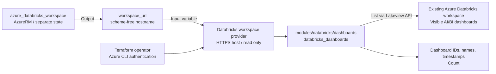

# Databricks Playground Scenario

Connect to an existing Azure Databricks workspace using the `databricks/databricks`
provider and Azure CLI authentication. The reusable
[dashboards module](../../modules/databricks/dashboards/) reads
`databricks_dashboards` and exposes dashboard metadata and a count.

## Scope

- Read AI/BI (Lakeview) dashboards visible to the authenticated identity, with
  an optional case-insensitive display-name substring filter.
- Return only `dashboard_id`, `display_name`, and `create_time`, not dashboard contents.
  An empty workspace or no matching dashboards returns `[]` and count `0`.
  Authentication, connectivity, and permission errors remain provider errors.
- Do not create, update, or delete workspaces, dashboards, permissions, clusters,
  notebooks, or SQL warehouses. Legacy SQL dashboards are not included.
- Keep workspace provisioning and this read in separate Terraform configurations
  and states. There is no remote-state dependency or AzureRM provider in this scenario.

## Prerequisites

Follow the shared [provider authentication](../../../docs/tips/provider-authentication.md#databricks),
[Terraform workflow](../../../docs/tips/terraform-workflow.md), and optional
[Azure Blob backend](../../../docs/tips/azure-blob-backend.md) guides.

- Terraform **1.6 or later** for the configuration; **1.9 or later** for native mock tests.
- Azure CLI installed and authenticated in the workspace's tenant.
  The provider explicitly uses `auth_type = "azure-cli"`. PAT and Databricks CLI are not required.
- An existing workspace, such as one deployed by
  [azure_databricks_workspace](../azure_databricks_workspace/README.md).
  The identity needs workspace access and permission to view the dashboards.
  Azure RBAC alone does not grant these Databricks data-plane permissions.
- HTTPS connectivity to the workspace endpoint.
  You may prepare AI/BI dashboards manually or with a separate configuration; none
  need to exist for this scenario to succeed. Listing does not start compute.

## Architecture



## Inputs

| Variable | Default | Description |
| --- | --- | --- |
| `workspace_url` | Required | Workspace DNS hostname, for example `adb-1234567890123456.7.azuredatabricks.net`. No scheme, path, port, or whitespace; at most 253 characters with DNS labels of at most 63 characters. |
| `dashboard_name_contains` | `null` | Case-insensitive substring of the dashboard display name. Omitted, `null`, or `""` reads all visible dashboards. |

The provider constructs `https://<workspace_url>`. Pass the provisioning scenario's
`workspace_url` output, **not** its `databricks_host` HTTPS URL.
The module inherits the caller's provider; workspace connection and authentication
settings remain in the scenario's `providers.tf`.

## Outputs

| Output | Description |
| --- | --- |
| `databricks_host` | `https://<workspace_url>`, the workspace provider's connection URL. |
| `dashboards` | List of objects containing `dashboard_id`, `display_name`, and `create_time`. Timestamps are preserved as returned by the provider, including missing values. |
| `dashboard_count` | Number of visible dashboards matching the optional filter. This is not an administrator-wide inventory count. |

## How to use

Complete the shared Azure CLI authentication steps, then run in Bash from the
repository root. The provisioning scenario must already have been applied and
its state must be accessible:

```shell
set -e
TF_VAR_workspace_url="$(terraform -chdir=infra/scenarios/azure_databricks_workspace output -raw workspace_url)"
export TF_VAR_workspace_url
make init SCENARIO=databricks_playground
make lint plan SCENARIO=databricks_playground
```

The separate assignment ensures a failed output lookup is not hidden by `export`.
For a workspace provisioned elsewhere, instead set `TF_VAR_workspace_url` to its
scheme-free hostname. No Terraform state is copied between scenarios.

To filter by display name:

```shell
terraform -chdir=infra/scenarios/databricks_playground plan \
  -var='dashboard_name_contains=sales'
```

Review the plan's dashboard outputs. A plan reads the API but does not save the
outputs for `terraform output`. To persist the preceding filtered result to
this scenario's state, explicitly apply with the same inputs:

```shell
terraform -chdir=infra/scenarios/databricks_playground apply \
  -var='dashboard_name_contains=sales'
terraform -chdir=infra/scenarios/databricks_playground output -json dashboards
terraform -chdir=infra/scenarios/databricks_playground output -raw dashboard_count
```

This configuration has no managed resources: apply records the read results and
outputs in state without creating or modifying Databricks objects. Protect state
and saved plans because they contain workspace metadata. Re-run plan/apply to
refresh the result; `terraform output` alone does not re-query Databricks.

## Tests and CI

Native mock plan tests require Terraform **1.9 or later**. They require no
authentication and cover empty results, filter argument forwarding, exact HTTPS
host construction, and invalid hostname rejection:

```shell
terraform -chdir=infra/scenarios/databricks_playground init -backend=false -lockfile=readonly -input=false
terraform -chdir=infra/scenarios/databricks_playground fmt -check -recursive
terraform -chdir=infra/scenarios/databricks_playground validate
terraform -chdir=infra/scenarios/databricks_playground test

terraform -chdir=infra/modules/databricks/dashboards init -backend=false -input=false
terraform -chdir=infra/modules/databricks/dashboards fmt -check -recursive
terraform -chdir=infra/modules/databricks/dashboards validate
terraform -chdir=infra/modules/databricks/dashboards test
```

Terraform's [nested-attribute mock limitation](https://github.com/hashicorp/terraform/issues/38369)
prevents supplying non-empty list fixtures to this data source's Plugin Framework
schema. Additional tests therefore run the **real provider against a local static
API fixture**, retaining the current provider version and testing actual
case-insensitive filtering, multiple results, missing timestamps, metadata-only
output shape, and empty filtered results:

```shell
sh infra/modules/databricks/dashboards/tests/test_fixture_api.sh
```

This runner also needs Python 3 and curl. It uses Python's standard-library HTTP
server on an ephemeral port bound to `127.0.0.1`, a dummy test token, isolated
temporary `TF_DATA_DIR` directories, and plan-only test runs. It stops its server
and removes temporary data on exit. The fixture tests live outside the default
test directory and are selected only by this runner; the dummy token is not a
real credential and is never used with the Azure workspace.

The [test workflow](../../../.github/workflows/test.yml) includes
`test-databricks-mock` for both native mock and local API fixture tests. No Azure
login, environment approval, Secrets, real-workspace API calls, apply, or destroy
are used. Passing these tests does not prove real Azure CLI authentication,
workspace connectivity, or actual permissions; use a manual real-workspace plan
for those checks.

## References

- [Databricks Terraform provider on Microsoft Learn](https://learn.microsoft.com/azure/databricks/dev-tools/terraform/)
- [Azure CLI authentication](https://learn.microsoft.com/azure/databricks/dev-tools/auth/azure-cli)
- [databricks_dashboards data source](https://registry.terraform.io/providers/databricks/databricks/latest/docs/data-sources/dashboards)

Unlike the Learn provisioning examples, this scenario uses a reusable
Databricks module to read dashboard metadata only; it does not create notebooks,
clusters, or jobs.
