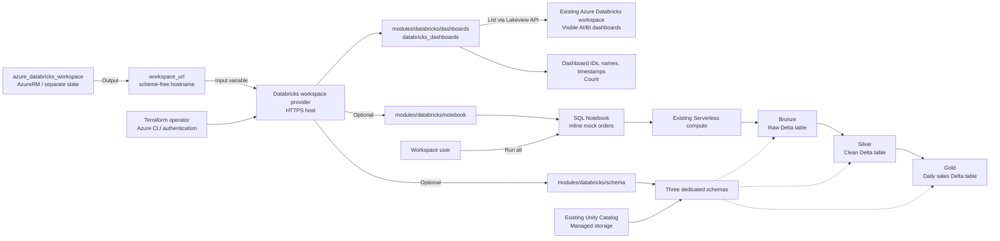

# Databricks Playground Scenario

Connect to an existing Azure Databricks workspace using the `databricks/databricks`
provider and Azure CLI authentication. The reusable
[dashboards module](../../modules/databricks/dashboards/) reads
`databricks_dashboards` and exposes dashboard metadata and a count.
Optionally deploy three dedicated Unity Catalog schemas and a SQL Notebook for a
**Bronze → Silver → Gold** hands-on with fixed mock orders. Reusable
[schema](../../modules/databricks/schema/) and
[notebook](../../modules/databricks/notebook/) modules manage the Databricks resources.

## Scope

- Read AI/BI (Lakeview) dashboards visible to the authenticated identity, with
  an optional case-insensitive display-name substring filter.
- Return only `dashboard_id`, `display_name`, and `create_time`, not dashboard contents.
  An empty workspace or no matching dashboards returns `[]` and count `0`.
  Authentication, connectivity, and permission errors remain provider errors.
- Leave `medallion_catalog_name` unset for the existing read-only behavior.
  Specifying an existing catalog adds **three schemas and one SQL Notebook**.
  Terraform deploys these objects but does not run the Notebook; **Run all** creates
  three Delta managed tables from inline mock data.
- Do not create workspaces, catalogs, permissions, clusters, SQL warehouses, Jobs,
  or Lakeflow pipelines. No external storage, data source, or additional package is needed.
  Legacy SQL dashboards are not included.
- Keep workspace provisioning and this scenario in separate Terraform configurations
  and states. There is no remote-state dependency or AzureRM provider in this scenario.

## Prerequisites

Follow the shared [provider authentication](../../../docs/tips/provider-authentication.md#databricks),
[Terraform workflow](../../../docs/tips/terraform-workflow.md), and optional
[Azure Blob backend](../../../docs/tips/azure-blob-backend.md) guides.

- Terraform **1.6 or later** for the configuration; **1.9 or later** for native mock tests.
- Azure CLI installed and authenticated in the workspace's tenant.
  The provider explicitly uses `auth_type = "azure-cli"`. PAT and Databricks CLI are not required.
- An existing workspace, such as one deployed by
  [azure_databricks_workspace](../azure_databricks_workspace/README.md).
  The identity needs workspace access and permission to view the dashboards.
  Azure RBAC alone does not grant these Databricks data-plane permissions.
- HTTPS connectivity to the workspace endpoint.
  You may prepare AI/BI dashboards manually or with a separate configuration; none
  need to exist for this scenario to succeed. Listing does not start compute.

For the optional hands-on:

- Unity Catalog and Serverless Notebook compute must be available in the workspace.
  Use an existing writable catalog with managed-table storage configured, such as
  the workspace catalog visible in **Catalog Explorer**. Passing a workspace URL
  alone does not guarantee these prerequisites.
- The Terraform identity needs `USE CATALOG` and `CREATE SCHEMA` on that catalog,
  and permission to create the Notebook under `/Shared`. Run the Notebook as the
  same Databricks user; sharing with other identities and granting permissions are out of scope.
- Choose an unused schema prefix and Notebook path. Dedicated schemas and their
  contents are **disposable**; do not reuse existing objects or store unrelated data there.
- This scenario does not bootstrap Unity Catalog, configure managed storage, or
  enable Serverless. Resolve missing prerequisites before applying; there is no
  fallback to Hive metastore or a newly provisioned cluster.
- Serverless execution and managed-table storage can incur charges.

## Architecture



## Inputs

| Variable | Default | Description |
| --- | --- | --- |
| `workspace_url` | Required | Workspace DNS hostname, for example `adb-1234567890123456.7.azuredatabricks.net`. No scheme, path, port, or whitespace; at most 253 characters with DNS labels of at most 63 characters. |
| `dashboard_name_contains` | `null` | Case-insensitive substring of the dashboard display name. Omitted, `null`, or `""` reads all visible dashboards. |
| `medallion_catalog_name` | `null` | Existing writable Unity Catalog catalog with managed storage. `null` disables the hands-on. When specified, 1-255 ASCII letters, numbers, underscores, or hyphens, not starting with a hyphen. Empty values, `hive_metastore`, and `system` are rejected. |
| `medallion_schema_prefix` | `medallion_playground` | Dedicated schema and Notebook prefix: 1-248 lowercase ASCII letters, numbers, or underscores, starting with a letter. Layer suffixes fit within the 255-character schema limit. |

The provider constructs `https://<workspace_url>`. Pass the provisioning scenario's
`workspace_url` output, **not** its `databricks_host` HTTPS URL.
The module inherits the caller's provider; workspace connection and authentication
settings remain in the scenario's `providers.tf`.

## Outputs

| Output | Description |
| --- | --- |
| `databricks_host` | `https://<workspace_url>`, the workspace provider's connection URL. |
| `dashboards` | List of objects containing `dashboard_id`, `display_name`, and `create_time`. Timestamps are preserved as returned by the provider, including missing values. |
| `dashboard_count` | Number of visible dashboards matching the optional filter. This is not an administrator-wide inventory count. |
| `medallion` | `null` when disabled; otherwise an object with `catalog_name`, `schemas` and `tables` maps keyed by `bronze` / `silver` / `gold`, `notebook_path`, and `notebook_url`. Tables exist only after running the Notebook. |

## How to use

Complete the shared Azure CLI authentication steps, then run in Bash from the
repository root. The provisioning scenario must already have been applied and
its state must be accessible:

```shell
set -e
TF_VAR_workspace_url="$(terraform -chdir=infra/scenarios/azure_databricks_workspace output -raw workspace_url)"
export TF_VAR_workspace_url
make init SCENARIO=databricks_playground
make lint plan SCENARIO=databricks_playground
```

The separate assignment ensures a failed output lookup is not hidden by `export`.
For a workspace provisioned elsewhere, instead set `TF_VAR_workspace_url` to its
scheme-free hostname. No Terraform state is copied between scenarios.

To filter by display name:

```shell
terraform -chdir=infra/scenarios/databricks_playground plan \
  -var='dashboard_name_contains=sales'
```

Review the plan's dashboard outputs. A plan reads the API but does not save the
outputs for `terraform output`. To persist the preceding filtered result to
this scenario's state, explicitly apply with the same inputs:

```shell
terraform -chdir=infra/scenarios/databricks_playground apply \
  -var='dashboard_name_contains=sales'
terraform -chdir=infra/scenarios/databricks_playground output -json dashboards
terraform -chdir=infra/scenarios/databricks_playground output -raw dashboard_count
```

With the hands-on disabled, this configuration has no managed resources: apply
records the read results and outputs without modifying Databricks objects. Protect state
and saved plans because they contain workspace metadata. Re-run plan/apply to
refresh the result; `terraform output` alone does not re-query Databricks.

## Medallion hands-on

### Provision with Terraform

After setting `TF_VAR_workspace_url` as above, supply the **actual existing catalog
name** from Catalog Explorer. The following placeholder must be replaced:

```shell
export TF_VAR_medallion_catalog_name="your_existing_catalog"
export TF_VAR_medallion_schema_prefix="medallion_playground"
make init SCENARIO=databricks_playground
make lint plan SCENARIO=databricks_playground
terraform -chdir=infra/scenarios/databricks_playground apply
terraform -chdir=infra/scenarios/databricks_playground output -json medallion
```

For concurrent learners, choose a different prefix for each learner. Terraform
creates `<prefix>_bronze`, `<prefix>_silver`, and `<prefix>_gold` in the selected
catalog and places the Notebook at `/Shared/<prefix>`. It does not create a catalog,
start compute, or materialize tables.

### Run and verify in Databricks

1. Open `notebook_url` from the `medallion` output, as the same user that applied Terraform.
2. Select **Serverless** in the Notebook compute selector, then **Run all**.
   No Notebook parameter edits, uploads, package installs, or CLI scripts are needed.
3. Inspect the displayed raw, clean, and aggregate results:
   - **Bronze**: `orders_raw`, 10 raw events including one duplicate and five invalid events.
   - **Silver**: `orders`, 4 orders after type conversion, invalid-value filtering,
     and deterministic deduplication by ingestion sequence.
   - **Gold**: `daily_sales`, 3 daily/region groups, with DECIMAL sales totaling **390.00**.
4. The verification cells must finish without errors. `assert_true` returns `NULL`
   on success and raises an error on mismatches. Checks cover counts, unique order
   IDs, invalid values, total sales, and every Gold row in both directions.
5. In Catalog Explorer, inspect the three dedicated schemas and their Delta managed
   tables. The `tables` output supplies their fully qualified names.
6. Run **Run all** again. The Notebook uses `CREATE OR REPLACE TABLE`; results must
   remain identical rather than accumulating new rows.

Expected Gold results:

| order_date | region | order_count | total_quantity | total_amount |
| --- | --- | --- | --- | --- |
| 2026-01-01 | North | 2 | 3 | 250.00 |
| 2026-01-01 | South | 1 | 3 | 60.00 |
| 2026-01-02 | South | 1 | 1 | 80.00 |

The [SQL Notebook source](./notebooks/medallion.sql.tftpl) includes the explanation,
data, transformations, and checks. It uses only the three dedicated tables;
Terraform does not separately manage their definitions.

### Cleanup and data lifecycle

Using the **same workspace, catalog, and prefix inputs**, remove the playground objects:

```shell
terraform -chdir=infra/scenarios/databricks_playground destroy
```

The schema calls explicitly set `force_destroy = true`: the dedicated schemas and
**all their contents**, including the Notebook-created tables, are deleted alongside
the Notebook. The existing catalog and Azure Workspace remain.
Do not add unrelated data to these schemas. Each Notebook run replaces the three
hands-on tables, so edits to their data are not preserved.

Unsetting the catalog after provisioning also plans deletion of the hands-on.
Changing the catalog or prefix can replace and delete the old dedicated schemas.
Review the plan carefully; these changes are not a way to preserve existing mock data.

## Tests and CI

Native mock plan tests require Terraform **1.9 or later**. They require no
authentication and cover empty results, filter argument forwarding, exact HTTPS
host construction, and invalid hostname rejection. Additional tests cover opt-in
resource counts, schema protection and explicit force deletion, Notebook content
and outputs, custom qualified names, disabled behavior, and invalid-input boundaries:

```shell
terraform -chdir=infra/scenarios/databricks_playground init -backend=false -lockfile=readonly -input=false
terraform -chdir=infra/scenarios/databricks_playground fmt -check -recursive
terraform -chdir=infra/scenarios/databricks_playground validate
terraform -chdir=infra/scenarios/databricks_playground test

for module in dashboards schema notebook; do
  terraform -chdir="infra/modules/databricks/$module" init -backend=false -input=false
  terraform -chdir="infra/modules/databricks/$module" fmt -check -recursive
  terraform -chdir="infra/modules/databricks/$module" validate
  terraform -chdir="infra/modules/databricks/$module" test
done
```

Terraform's [nested-attribute mock limitation](https://github.com/hashicorp/terraform/issues/38369)
prevents supplying non-empty list fixtures to this data source's Plugin Framework
schema. Additional tests therefore run the **real provider against a local static
API fixture**, retaining the current provider version and testing actual
case-insensitive filtering, multiple results, missing timestamps, metadata-only
output shape, and empty filtered results:

```shell
sh infra/modules/databricks/dashboards/tests/test_fixture_api.sh
```

This runner also needs Python 3 and curl. It uses Python's standard-library HTTP
server on an ephemeral port bound to `127.0.0.1`, a dummy test token, isolated
temporary `TF_DATA_DIR` directories, and plan-only test runs. It stops its server
and removes temporary data on exit. The fixture tests live outside the default
test directory and are selected only by this runner; the dummy token is not a
real credential and is never used with the Azure workspace.

The [test workflow](../../../.github/workflows/test.yml) includes
`test-databricks-mock` for both native mock and local API fixture tests. No Azure
login, environment approval, Secrets, real-workspace API calls, apply, or destroy
are used. Passing these tests does not prove real Azure CLI authentication,
workspace connectivity, or actual permissions. The fixture tests explicitly disable
the hands-on and only call the local Lakeview API. A mock plan does not execute SQL,
test managed storage, or prove Serverless compatibility; use the manual hands-on
steps above for real-workspace acceptance.

## References

- [Databricks Terraform provider on Microsoft Learn](https://learn.microsoft.com/azure/databricks/dev-tools/terraform/)
- [Azure CLI authentication](https://learn.microsoft.com/azure/databricks/dev-tools/auth/azure-cli)
- [databricks_dashboards data source](https://registry.terraform.io/providers/databricks/databricks/latest/docs/data-sources/dashboards)
- [databricks_schema resource](https://registry.terraform.io/providers/databricks/databricks/latest/docs/resources/schema)
- [databricks_notebook resource](https://registry.terraform.io/providers/databricks/databricks/latest/docs/resources/notebook)
- [Unity Catalog setup](https://learn.microsoft.com/azure/databricks/data-governance/unity-catalog/setup-uc)
- [Serverless compute for notebooks](https://learn.microsoft.com/azure/databricks/compute/serverless/notebooks)

Unlike broader provisioning examples, this hands-on reuses an existing catalog and
Serverless compute. It creates no clusters, Jobs, or external storage.
