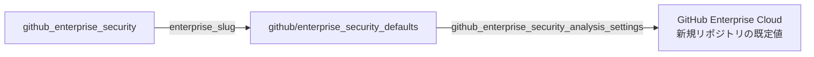

# GitHub Enterprise Security

`ghqr list-recommendations --scope enterprise` が示す Enterprise 単位の推奨事項のうち、
GitHub プロバイダーで設定できるものを適用します。GitHub Enterprise Cloud の Enterprise 全体で、
新規リポジトリのセキュリティ既定値を設定します。

## アーキテクチャ



## ghqr ルールとの対応

| ghqr | 設定 |
|------|------|
| ent-ghas-001 | 新規リポジトリの GitHub Advanced Security |
| ent-ghas-002 | 新規リポジトリのシークレットスキャン |
| ent-ghas-003 | 新規リポジトリのプッシュ保護（任意のカスタムリンク付き） |
| (追加) | シークレットの有効性チェック |

次のルールはプロバイダーで設定できません。

| ghqr | 理由 |
|------|------|
| ent-ghas-004..006 | Dependabot アラート、Dependabot セキュリティ更新、依存関係グラフの Enterprise 設定がありません。各 Organization で [github_organization_security](../github_organization_security/README.ja.md) を使用してください |
| ent-ghas-007 | 非プロバイダーパターンのシークレットスキャンの Enterprise 設定がありません |
| ent-alert-* | 未解決のアラートは設定ではなく修正で対応します |
| ent-budget-* | 請求の予算はプロバイダーで管理しません |
| ent-log-* | 監査ログのイベントとストリーミングはプロバイダーで管理しません |
| ghes-* | GitHub Enterprise Server アプライアンスの設定はプロバイダーで管理しません |

## 前提条件

- [Terraform ワークフロー](../../../docs/tips/terraform-workflow.ja.md)の前提条件を満たします。
- [プロバイダー認証](../../../docs/tips/provider-authentication.ja.md#github)に従って、
  Enterprise オーナーの `GITHUB_TOKEN` を設定します。classic token には `admin:enterprise` スコープが必要です。
- ent-ghas-001 には GitHub Advanced Security のライセンスが必要です。ない場合は
  `advanced_security_enabled_for_new_repositories = false` を設定してください。

## 使用方法

`infra/scenarios/github_enterprise_security/terraform.tfvars` を作成します。
このファイルは Git 管理外です。

```hcl
enterprise_slug = "your-enterprise"

# 任意: プッシュ保護でシークレットがブロックされたときのバイパス申請方法を案内します。
secret_scanning_push_protection_custom_link = "https://example.com/security/push-protection"
```

リポジトリのルートで実行します。

```bash
export GITHUB_TOKEN=$(gh auth token)
make init SCENARIO=github_enterprise_security
make plan SCENARIO=github_enterprise_security
make deploy SCENARIO=github_enterprise_security
```

ghqr で結果を確認します。

```bash
./ghqr scan -e your-enterprise
```

## 変数

| 名前 | 型 | 説明 | 既定値 |
|------|------|------|--------|
| `enterprise_slug` | `string` | 小文字の Enterprise slug | (必須) |
| `advanced_security_enabled_for_new_repositories` | `bool` | ent-ghas-001。GHAS ライセンスが必要 | `true` |
| `secret_scanning_enabled_for_new_repositories` | `bool` | ent-ghas-002 | `true` |
| `secret_scanning_push_protection_enabled_for_new_repositories` | `bool` | ent-ghas-003 | `true` |
| `secret_scanning_push_protection_custom_link` | `string` | プッシュ保護でブロックしたときに表示する URL | `null` |
| `secret_scanning_validity_checks_enabled` | `bool` | 検出したシークレットの有効性チェック | `true` |

## 出力

| 名前 | 説明 |
|------|------|
| `enterprise_slug` | 管理対象の Enterprise slug |
| `security_defaults` | 適用した新規リポジトリのセキュリティ既定値 |

## オフラインテスト

テストは mock GitHub provider と `command = plan` を使用します。
資格情報は不要で、GitHub API を呼び出しません。

```bash
export TF_DATA_DIR=$(mktemp -d)
terraform -chdir=infra/scenarios/github_enterprise_security init -backend=false -lockfile=readonly -input=false
terraform -chdir=infra/scenarios/github_enterprise_security validate
terraform -chdir=infra/scenarios/github_enterprise_security test
```

[CI](../../../.github/workflows/test.yml) の `test-github-mock` job は同じ確認を実行します。
このシナリオは Enterprise オーナーの権限が必要なため、実 API を使う `test-github` job には含めていません。
