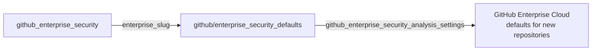

# GitHub Enterprise Security

This scenario applies the enterprise-scope recommendations reported by
`ghqr list-recommendations --scope enterprise` that the GitHub provider can configure.
It sets the security defaults for new repositories across a GitHub Enterprise Cloud enterprise.

## Architecture



## ghqr rule mapping

| ghqr | Setting |
|------|---------|
| ent-ghas-001 | GitHub Advanced Security for new repositories |
| ent-ghas-002 | Secret scanning for new repositories |
| ent-ghas-003 | Secret scanning push protection for new repositories (with an optional custom link) |
| (extra) | Secret scanning validity checks |

The provider cannot configure these rules:

| ghqr | Reason |
|------|--------|
| ent-ghas-004..006 | No enterprise setting for Dependabot alerts, Dependabot security updates, or the dependency graph; use [github_organization_security](../github_organization_security/README.md) for each organization |
| ent-ghas-007 | No enterprise setting for non-provider secret patterns |
| ent-alert-* | Open alerts must be remediated, not configured |
| ent-budget-* | Billing budgets are not managed by the provider |
| ent-log-* | Audit log events and streaming are not managed by the provider |
| ghes-* | GitHub Enterprise Server appliance settings are not managed by the provider |

## Prerequisites

- Meet the prerequisites of the [Terraform workflow](../../../docs/tips/terraform-workflow.md).
- Configure `GITHUB_TOKEN` for an enterprise owner by following
  [provider authentication](../../../docs/tips/provider-authentication.md#github).
  A classic token needs the `admin:enterprise` scope.
- ent-ghas-001 needs GitHub Advanced Security licenses. Set
  `advanced_security_enabled_for_new_repositories = false` without them.

## How to use

Create `infra/scenarios/github_enterprise_security/terraform.tfvars`.
The file is ignored by Git.

```hcl
enterprise_slug = "your-enterprise"

# Optional: explain how to request a bypass when push protection blocks a secret.
secret_scanning_push_protection_custom_link = "https://example.com/security/push-protection"
```

Then run from the repository root:

```bash
export GITHUB_TOKEN=$(gh auth token)
make init SCENARIO=github_enterprise_security
make plan SCENARIO=github_enterprise_security
make deploy SCENARIO=github_enterprise_security
```

Verify the result with ghqr:

```bash
./ghqr scan -e your-enterprise
```

## Variables

| Name | Type | Description | Default |
|------|------|-------------|---------|
| `enterprise_slug` | `string` | Lowercase enterprise slug | (required) |
| `advanced_security_enabled_for_new_repositories` | `bool` | ent-ghas-001; needs GHAS licenses | `true` |
| `secret_scanning_enabled_for_new_repositories` | `bool` | ent-ghas-002 | `true` |
| `secret_scanning_push_protection_enabled_for_new_repositories` | `bool` | ent-ghas-003 | `true` |
| `secret_scanning_push_protection_custom_link` | `string` | URL shown when push protection blocks a secret | `null` |
| `secret_scanning_validity_checks_enabled` | `bool` | Validity checks for detected secrets | `true` |

## Outputs

| Name | Description |
|------|-------------|
| `enterprise_slug` | Slug of the managed enterprise |
| `security_defaults` | Applied security defaults for new repositories |

## Offline tests

The tests use a mock GitHub provider and `command = plan`.
They need no credentials and make no GitHub API calls.

```bash
export TF_DATA_DIR=$(mktemp -d)
terraform -chdir=infra/scenarios/github_enterprise_security init -backend=false -lockfile=readonly -input=false
terraform -chdir=infra/scenarios/github_enterprise_security validate
terraform -chdir=infra/scenarios/github_enterprise_security test
```

The `test-github-mock` job in [CI](../../../.github/workflows/test.yml) runs the same checks.
This scenario is not part of the live `test-github` job because it needs enterprise owner rights.
