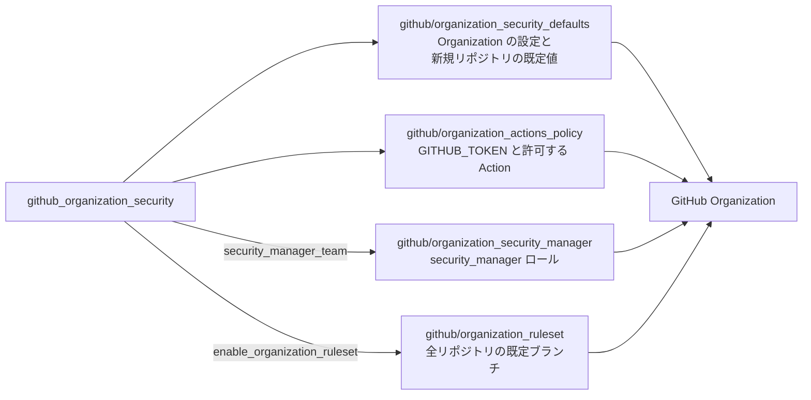

# GitHub Organization Security

`ghqr list-recommendations --scope organization` が示す Organization 単位の推奨事項を、
1 つの GitHub Organization に適用します。部品ごとに個別のモジュールになっており、無効化できます。

## アーキテクチャ



## ghqr ルールとの対応

| ghqr | 設定 | モジュール |
|------|------|------------|
| org-def-001 | 新規リポジトリの Dependabot アラート | `organization_security_defaults` |
| org-def-002 | 新規リポジトリの Dependabot セキュリティ更新 | `organization_security_defaults` |
| org-def-003 | 新規リポジトリの依存関係グラフ | `organization_security_defaults` |
| org-def-004 | 新規リポジトリのシークレットスキャン | `organization_security_defaults` |
| org-def-005 | 新規リポジトリのプッシュ保護 | `organization_security_defaults` |
| org-def-006 | 新規リポジトリの GitHub Advanced Security（既定は無効。ライセンスが必要） | `organization_security_defaults` |
| org-sec-002 | Web コミットの sign-off を必須化 | `organization_security_defaults` |
| org-sec-003 | 基本権限を `read` に設定（`admin` は拒否） | `organization_security_defaults` |
| org-sec-004 | メンバーによる Public リポジトリの作成を禁止 | `organization_security_defaults` |
| org-act-001 | 読み取り専用の `GITHUB_TOKEN`。Action による Pull Request の承認を禁止 | `organization_actions_policy` |
| org-act-002, 003 | `selected`: GitHub 製、検証済み作成者、`patterns_allowed` の Action を許可 | `organization_actions_policy` |
| org-sec-005 | `security_manager` ロールを Team に割り当て | `organization_security_manager` |
| repo-bp-*（Organization 全体） | `~ALL` リポジトリの `~DEFAULT_BRANCH` に任意の Organization Ruleset | `organization_ruleset` |

次のルールはプロバイダーで設定できません。

| ghqr | 理由 |
|------|------|
| org-sec-001 | 2 要素認証の必須化は GitHub API で公開されていません |
| org-sec-006 | Enterprise Managed Users 向けの情報提供です |
| org-def-007 | 新規リポジトリの非公開の脆弱性報告に対応する設定がプロバイダーにありません |
| org-cop-* | Copilot のポリシーとシートはプロバイダーで管理しません |
| org-alert-* | 未解決のアラートは設定ではなく修正で対応します |

## 前提条件

- [Terraform ワークフロー](../../../docs/tips/terraform-workflow.ja.md)の前提条件を満たします。
- [プロバイダー認証](../../../docs/tips/provider-authentication.ja.md#github)に従って、
  Organization オーナーの `GITHUB_TOKEN` を設定します。classic token には `admin:org` スコープが必要です。
- `github_organization_settings` は Organization の**すべての**設定を管理します。このシナリオが
  渡さない引数は apply 時にプロバイダーの既定値に戻ります。既存の Organization に適用する前に
  plan を十分に確認してください。
- Organization Ruleset には GitHub Team または Enterprise が必要です。`evaluate` には Enterprise が必要です。

## 使用方法

`infra/scenarios/github_organization_security/terraform.tfvars` を作成します。
このファイルは Git 管理外です。

```hcl
organization  = "your-org"
billing_email = "billing@example.com"

security_defaults = {
  # GitHub Advanced Security のライセンスがある場合だけ有効にします。
  advanced_security_enabled_for_new_repositories = false
}

actions_policy = {
  patterns_allowed = ["hashicorp/setup-terraform@*"]
}

security_manager_team = {
  slug   = "security-managers"
  create = true
}

enable_organization_ruleset = false
organization_ruleset = {
  enforcement   = "evaluate"
  bypass_actors = [{ actor_id = 1, actor_type = "OrganizationAdmin", bypass_mode = "always" }]
}
```

リポジトリのルートで実行します。

```bash
export GITHUB_TOKEN=$(gh auth token)
make init SCENARIO=github_organization_security
make plan SCENARIO=github_organization_security
make deploy SCENARIO=github_organization_security
```

ghqr で結果を確認します。

```bash
./ghqr scan -o your-org
```

この例ではプランの制約を避けるため、Organization Ruleset を無効にしています。
GitHub Team で有効にする場合は、`enable_organization_ruleset = true` と
`enforcement = "active"` を設定してください。Enterprise では `enforcement = "evaluate"` で開始し、
rule insights で影響を確認してから `active` に切り替えられます。

## トラブルシューティング

### `GET /orgs/{org}/organization-roles` が `404 Not Found` になる

`security_manager_team` を指定すると、セキュリティマネージャーモジュールはこの API から
`security_manager` ロールを取得します。GitHub は Organization が存在しない場合だけでなく、
アクセス権が不足している場合にも 404 を返すことがあります。

ロールを割り当てるには、認証したアカウントが Organization オーナーである必要があります。
classic PAT または GitHub CLI の OAuth トークンを使う場合、
[Organization Roles API](https://docs.github.com/en/rest/orgs/organization-roles#get-all-organization-roles-for-an-organization)
には `admin:org` が必要です。アカウントがオーナーでも、`read:org` だけでは不足します。

GitHub CLI の保存済みログインを使う場合は、リポジトリのルートで次を実行してください。
`your-org` は対象の Organization のログイン名に置き換えます。トークンの環境変数による
保存済みログインの上書きを解除し、更新したトークンを Terraform に渡し直します。

```bash
unset GH_TOKEN GITHUB_TOKEN
gh auth refresh --hostname github.com --scopes admin:org
export GITHUB_TOKEN="$(gh auth token --hostname github.com)"

GH_TOKEN="$GITHUB_TOKEN" gh api orgs/your-org/organization-roles --jq '.roles[].name'
make plan SCENARIO=github_organization_security
```

別途発行した classic PAT を使う場合は、そのトークンに `admin:org` を追加し、
`GITHUB_TOKEN` を更新してください。トークンを Terraform ファイルに書き込まないでください。
引き続き API が 404 を返す場合は、Organization のログイン名と認証したアカウントの
オーナー権限を確認し、必要ならトークンの SAML SSO 承認も行ってください。

### `POST /orgs/{org}/rulesets` が `403 Upgrade to GitHub Team` になる

このエラーはトークンのスコープ不足ではなく、プランの制約を示します。
Organization Ruleset には GitHub Team または Enterprise が必要で、
`evaluate` には Enterprise が必要です。

GitHub Free では、既存の
`infra/scenarios/github_organization_security/terraform.tfvars` に次を設定し、
Ruleset の作成をスキップしてください。

```hcl
enable_organization_ruleset = false
```

変数の既定値と上記の例はすでに `false` ですが、README を更新しても、既存の
`terraform.tfvars` に設定した `true` は自動で変更されません。
リポジトリのルートで `make plan SCENARIO=github_organization_security` を実行し、
Organization Ruleset が作成されないことを確認してから再デプロイしてください。
すでに state で管理している Ruleset がある場合、無効化すると削除が計画されるため、
apply 前に plan を確認してください。

## 変数

| 名前 | 型 | 説明 | 既定値 |
|------|------|------|--------|
| `organization` | `string` | Organization のログイン名。`null` の場合は何も管理しない | `null` |
| `billing_email` | `string` | 請求先メールアドレス。`enable_security_defaults` が true の場合は必須 | `null` |
| `enable_security_defaults` | `bool` | Organization の設定と新規リポジトリの既定値を管理するか | `true` |
| `security_defaults` | `object` | `organization_security_defaults` の上書き。省略した値はモジュールの既定値 | `{}` |
| `enable_actions_policy` | `bool` | Organization の Actions ポリシーを管理するか | `true` |
| `actions_policy` | `object` | `default_workflow_permissions`、`can_approve_pull_request_reviews`、`allowed_actions`、`patterns_allowed`、`verified_allowed`、`sha_pinning_required` | `{}` |
| `security_manager_team` | `object` | セキュリティマネージャー Team の `slug`、`create`、`description`。`null` の場合は割り当てない | `null` |
| `enable_organization_ruleset` | `bool` | Organization Ruleset を作成するか | `false` |
| `organization_ruleset` | `object` | `name`、`enforcement`、`repository_name_include`、`repository_name_exclude`、`bypass_actors`、`rules` | `{}` |

## 出力

| 名前 | 説明 |
|------|------|
| `organization` | Organization のログイン名、または `null` |
| `security_defaults` | 適用した Organization のセキュリティ設定、または `null` |
| `actions_default_workflow_permissions` | `GITHUB_TOKEN` の既定の権限、または `null` |
| `actions_allowed_actions` | 許可する Action のポリシー、または `null` |
| `security_manager_team_slug` | セキュリティマネージャーロールを割り当てた Team、または `null` |
| `organization_ruleset_name` | Organization Ruleset の名前、または `null` |

## オフラインテスト

テストは mock GitHub provider と `command = plan` を使用します。
資格情報は不要で、GitHub API を呼び出しません。

```bash
export TF_DATA_DIR=$(mktemp -d)
terraform -chdir=infra/scenarios/github_organization_security init -backend=false -lockfile=readonly -input=false
terraform -chdir=infra/scenarios/github_organization_security validate
terraform -chdir=infra/scenarios/github_organization_security test
```

[CI](../../../.github/workflows/test.yml) の `test-github-mock` job は同じ確認を実行します。
このシナリオは Organization オーナーの権限が必要なため、実 API を使う `test-github` job には含めていません。
