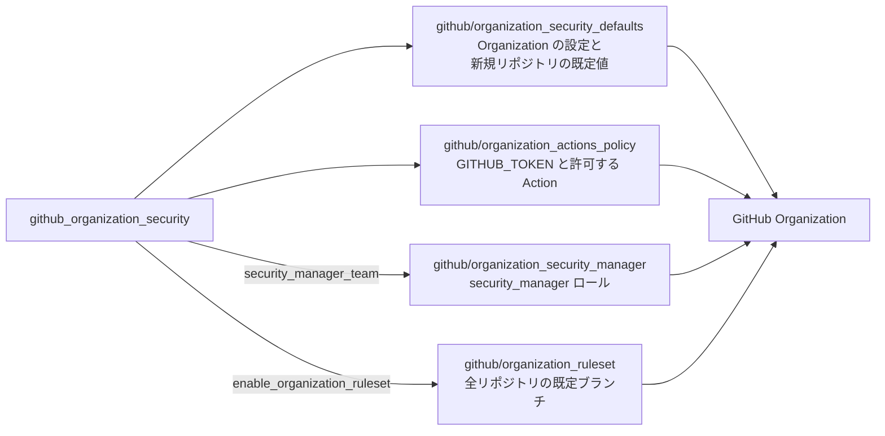

# GitHub Organization Security

`ghqr list-recommendations --scope organization` が示す Organization 単位の推奨事項を、
1 つの GitHub Organization に適用します。部品ごとに個別のモジュールになっており、無効化できます。

## アーキテクチャ



## 管理するリソース

`organization` を指定すると、このシナリオは最大 6 つのリソースを管理します。
GitHub 上に新しいオブジェクトを作成するのは `github_team` と `github_organization_ruleset` です。
それ以外のリソースは、既存の Organization の設定を上書きします。
`organization` が `null` の場合は何も管理しません。

| # | リソース | 管理する条件 | 内容 | モジュール |
|---|----------|--------------|------|------------|
| 1 | `github_organization_settings` | `enable_security_defaults = true`（既定値） | Organization の設定と新規リポジトリの既定値を上書き | `organization_security_defaults` |
| 2 | `github_actions_organization_workflow_permissions` | `enable_actions_policy = true`（既定値） | `GITHUB_TOKEN` の既定の権限と、Actions による Pull Request の承認可否を設定 | `organization_actions_policy` |
| 3 | `github_actions_organization_permissions` | `enable_actions_policy = true`（既定値） | Actions を実行できるリポジトリと、許可する Action を設定 | `organization_actions_policy` |
| 4 | `github_team` | `security_manager_team.create = true` | セキュリティマネージャー用の Team を作成 | `organization_security_manager` |
| 5 | `github_organization_role_team` | `security_manager_team` を指定 | Team に `security_manager` ロールを割り当て | `organization_security_manager` |
| 6 | `github_organization_ruleset` | `enable_organization_ruleset = true` | 対象リポジトリの既定ブランチに Branch Ruleset を作成 | `organization_ruleset` |

`security_manager_team` を指定すると、`security_manager` ロールの ID を調べるために
`github_organization_roles` data source も読み取ります。この data source は何も作成しませんが、
`admin:org` スコープが必要です（[トラブルシューティング](#トラブルシューティング)を参照）。

[使用方法](#使用方法)の例では 1〜5 のリソースを管理し、Organization Ruleset は作成しません。

### Organization の設定

`github_organization_settings` は次の値を適用します。`security_defaults` で上書きできます。
`*_for_new_repositories` の設定は、**適用後に作成するリポジトリだけ**が対象です。既存のリポジトリの設定は変わりません。

| 設定 | 既定値 | 説明 | ghqr |
|------|--------|------|------|
| `default_repository_permission` | `read` | Organization のメンバー全員が、すべてのリポジトリに対して持つ基本権限です。`none`、`read`、`write` を指定できます。このシナリオでは `admin` を拒否します。`none` にすると、Team やリポジトリ単位で付与した権限だけが有効になります。 | org-sec-003 |
| `members_can_create_repositories` | `true` | メンバーがリポジトリを作成できるか。`false` にすると、Organization オーナーだけが作成できます。 | - |
| `members_can_create_public_repositories` | `false` | メンバーが Public リポジトリを作成できるか。意図しないコードの公開を防ぐため、既定で禁止します。 | org-sec-004 |
| `members_can_create_private_repositories` | `true` | メンバーが Private リポジトリを作成できるか。 | - |
| `members_can_create_public_pages` | `false` | メンバーが Public な GitHub Pages サイトを公開できるか。 | - |
| `members_can_fork_private_repositories` | `false` | メンバーが Private リポジトリを fork できるか。禁止すると、管理しにくいコードの複製が増えるのを防げます。 | - |
| `web_commit_signoff_required` | `true` | GitHub の Web UI でコミットするときに、作成者の sign-off（`Signed-off-by` トレーラー）を必須にするか。 | org-sec-002 |
| `advanced_security_enabled_for_new_repositories` | `false` | 新規リポジトリで GitHub Advanced Security を自動で有効にするか。ライセンスが必要なため、既定では無効です。 | org-def-006 |
| `dependabot_alerts_enabled_for_new_repositories` | `true` | 依存パッケージに既知の脆弱性が見つかったときに、Dependabot がアラートを作成するか。依存関係グラフが必要です。 | org-def-001 |
| `dependabot_security_updates_enabled_for_new_repositories` | `true` | 脆弱な依存パッケージを修正済みのバージョンに更新する Pull Request を、Dependabot が自動で作成するか。Dependabot アラートが必要です。 | org-def-002 |
| `dependency_graph_enabled_for_new_repositories` | `true` | マニフェストやロックファイルから依存関係を解析するか。Dependabot アラートの前提となる機能です。 | org-def-003 |
| `secret_scanning_enabled_for_new_repositories` | `true` | リポジトリにコミットされたトークンやパスワードなどのシークレットを検出するか。Private リポジトリでは GitHub Secret Protection が必要です。 | org-def-004 |
| `secret_scanning_push_protection_enabled_for_new_repositories` | `true` | シークレットを含む push をブロックするか。シークレットスキャンが有効である必要があります。 | org-def-005 |

このシナリオは Organization の表示名と説明を渡しません。
シナリオが渡さない設定は、apply 時にプロバイダーの既定値に戻る可能性があります。

### GitHub Actions のポリシー

2 つの Actions リソースは次の値を適用します。変更可能な値は `actions_policy` で上書きできます。

| 設定 | 既定値 | 変更 | 説明 |
|------|--------|------|------|
| `default_workflow_permissions` | `read` | 可 | ワークフローの `GITHUB_TOKEN` に既定で付与する権限です。`read` はリポジトリの内容とパッケージの読み取りだけを許可し、`write` はすべてのスコープの読み書きを許可します。書き込みが必要なワークフローでは、`permissions` キーで必要な権限だけを明示的に付与します。 |
| `can_approve_pull_request_reviews` | `false` | 可 | GitHub Actions が Pull Request を承認できるか。許可すると、ワークフローが変更を自動で承認でき、レビュー要件を迂回される恐れがあります。 |
| `enabled_repositories` | `all` | 不可 | Actions を実行できるリポジトリです。このシナリオでは常に `all`（すべてのリポジトリ）です。 |
| `allowed_actions` | `selected` | 可 | 実行を許可する Action と再利用可能なワークフローです。`all` はすべて、`local_only` は Organization 内のリポジトリで定義したものだけを許可します。`selected` は Organization 内のものに加えて、下の 3 項目で許可したものを許可します。 |
| `github_owned_allowed` | `true` | 不可 | GitHub が作成した Action（`actions/*`、`github/*` など）を許可するか。 |
| `verified_allowed` | `true` | 可 | GitHub Marketplace で検証済みの作成者が公開した Action を許可するか。 |
| `patterns_allowed` | `[]` | 可 | 追加で許可する Action のパターンです。`owner/repo@*`、`owner/repo@v2`、`owner/*` の形式で、タグや SHA、ワイルドカードを指定できます。例: `hashicorp/setup-terraform@*`。 |
| `sha_pinning_required` | `false` | 可 | Action と再利用可能なワークフローを、完全なコミット SHA で参照することを必須にするか。有効にすると、`@v4` のようなタグで参照するワークフローは実行できなくなります。 |

`github_owned_allowed`、`verified_allowed`、`patterns_allowed` は
`allowed_actions = "selected"` の場合だけ適用されます。

### セキュリティマネージャー Team

`security_manager_team` には次の値を指定します。

| 設定 | 既定値 | 説明 |
|------|--------|------|
| `slug` | なし（必須） | ロールを割り当てる Team の slug です。`create = true` の場合は Team 名としても使います。slug と名前を一致させるため、小文字とハイフンの名前を推奨します。 |
| `create` | `false` | `true` の場合は Team を作成します。`false` の場合は既存の Team を使います。 |
| `description` | `Security managers (managed by Terraform)` | `create = true` で作成する Team の説明です。 |

| `security_manager_team.create` | 結果 |
|--------------------------------|------|
| `false`（既定値） | slug が `security_manager_team.slug` の既存 Team にロールを割り当てます。Team は事前に存在している必要があります。 |
| `true` | `security_manager_team.slug` という名前の Team を作成し、ロールを割り当てます。公開範囲は `closed`（Organization のすべてのメンバーに表示）です。 |

`security_manager` ロールを割り当てると、Team のメンバーは Organization のすべてのリポジトリの読み取り、
セキュリティアラートへの書き込み、セキュリティ設定の管理ができるようになります。
Team へのメンバーの追加は、このシナリオでは管理しません。

### Organization Ruleset

`github_organization_ruleset` はブランチを対象に次の値を適用します。
`organization_ruleset` で上書きできます。`rules.*` は `organization_ruleset.rules` の属性です。

| 設定 | 既定値 | 説明 |
|------|--------|------|
| `name` | `org-default-branch-protection` | Ruleset の名前です。Organization の設定画面に表示されます。 |
| `enforcement` | `active` | `active` はルールを強制します。`evaluate` はルールを強制せず、rule insights に結果だけを記録します（Enterprise のみ）。`disabled` はルールを無効にします。 |
| `repository_name_include` | `["~ALL"]` | 対象にするリポジトリ名のパターンです。`~ALL` はすべてのリポジトリを表します。 |
| `repository_name_exclude` | `[]` | 対象から除外するリポジトリ名のパターンです。 |
| 対象ブランチ | `~DEFAULT_BRANCH` | 各リポジトリの既定ブランチです。このシナリオでは変更できません。 |
| `bypass_actors` | `[]` | ルールを迂回できるアクターです。`actor_type` は `OrganizationAdmin`、`RepositoryRole`、`Team`、`Integration`、`DeployKey`、`EnterpriseOwner` から選びます。`bypass_mode` は `pull_request`（既定値。Pull Request 経由のときだけ迂回）、`always`（常に迂回）、`exempt`（ルールの適用対象外）から選びます。`OrganizationAdmin`、`EnterpriseOwner`、`DeployKey` では `actor_id` を省略します。 |
| `rules.required_approving_review_count` | `2` | マージ前に必要な承認数です。0〜10 を指定できます。 |
| `rules.dismiss_stale_reviews_on_push` | `true` | 新しいコミットが push されたときに、既存の承認を取り消すか。 |
| `rules.require_code_owner_review` | `true` | `CODEOWNERS` でコードオーナーが指定されたファイルを変更した場合に、コードオーナーの承認を必須にするか。 |
| `rules.require_last_push_approval` | `true` | 最新の push を、push した人以外が承認することを必須にするか。 |
| `rules.required_review_thread_resolution` | `true` | コードへのコメントのスレッドがすべて解決されるまで、マージを禁止するか。 |
| `rules.allowed_merge_methods` | `["squash", "rebase"]` | 許可するマージ方法です。`merge`、`squash`、`rebase` から 1 つ以上を指定します。`required_linear_history` が有効な場合、マージコミットを作る `merge` は使えません。 |
| `rules.non_fast_forward` | `true` | force push を禁止するか。 |
| `rules.deletion` | `true` | ブランチの削除を禁止するか。`bypass_actors` に含まれるアクターだけが削除できます。 |
| `rules.required_signatures` | `true` | 検証済みの署名（GPG、SSH、S/MIME）があるコミットだけを push できるようにするか。署名を設定していない開発者は push できなくなります。 |
| `rules.required_linear_history` | `true` | マージコミットの push を禁止するか。 |
| `rules.required_status_checks` | `[]` | マージ前に成功が必要なステータスチェックです。各要素に `context`（チェック名）と、省略可能な `integration_id`（チェックを作成する GitHub App の ID）を指定します。空の場合、このルールは作成しません。 |
| `rules.strict_required_status_checks_policy` | `true` | ベースブランチの最新の変更を取り込んだ状態で、チェックの成功を必須にするか。`required_status_checks` を指定した場合だけ有効です。 |
| `rules.required_code_scanning` | `[]` | マージ前に必要なコードスキャンの結果です。各要素に `tool`（既定値 `CodeQL`）、`alerts_threshold`（既定値 `errors`。`none`、`errors`、`errors_and_warnings`、`all`）、`security_alerts_threshold`（既定値 `high_or_higher`。`none`、`critical`、`high_or_higher`、`medium_or_higher`、`all`）を指定します。閾値以上のアラートがあるとマージをブロックします。空の場合、このルールは作成しません。 |

Organization Ruleset には GitHub Team または Enterprise が必要で、`evaluate` には Enterprise が必要です。

## ghqr ルールとの対応

| ghqr | 設定 | モジュール |
|------|------|------------|
| org-def-001 | 新規リポジトリの Dependabot アラート | `organization_security_defaults` |
| org-def-002 | 新規リポジトリの Dependabot セキュリティ更新 | `organization_security_defaults` |
| org-def-003 | 新規リポジトリの依存関係グラフ | `organization_security_defaults` |
| org-def-004 | 新規リポジトリのシークレットスキャン | `organization_security_defaults` |
| org-def-005 | 新規リポジトリのプッシュ保護 | `organization_security_defaults` |
| org-def-006 | 新規リポジトリの GitHub Advanced Security（既定は無効。ライセンスが必要） | `organization_security_defaults` |
| org-sec-002 | Web コミットの sign-off を必須化 | `organization_security_defaults` |
| org-sec-003 | 基本権限を `read` に設定（`admin` は拒否） | `organization_security_defaults` |
| org-sec-004 | メンバーによる Public リポジトリの作成を禁止 | `organization_security_defaults` |
| org-act-001 | 読み取り専用の `GITHUB_TOKEN`。Action による Pull Request の承認を禁止 | `organization_actions_policy` |
| org-act-002, 003 | `selected`: GitHub 製、検証済み作成者、`patterns_allowed` の Action を許可 | `organization_actions_policy` |
| org-sec-005 | `security_manager` ロールを Team に割り当て | `organization_security_manager` |
| repo-bp-*（Organization 全体） | `~ALL` リポジトリの `~DEFAULT_BRANCH` に任意の Organization Ruleset | `organization_ruleset` |

次のルールはプロバイダーで設定できません。

| ghqr | 理由 |
|------|------|
| org-sec-001 | 2 要素認証の必須化は GitHub API で公開されていません |
| org-sec-006 | Enterprise Managed Users 向けの情報提供です |
| org-def-007 | 新規リポジトリの非公開の脆弱性報告に対応する設定がプロバイダーにありません |
| org-cop-* | Copilot のポリシーとシートはプロバイダーで管理しません |
| org-alert-* | 未解決のアラートは設定ではなく修正で対応します |

## 前提条件

- [Terraform ワークフロー](../../../docs/tips/terraform-workflow.ja.md)の前提条件を満たします。
- [プロバイダー認証](../../../docs/tips/provider-authentication.ja.md#github)に従って、
  Organization オーナーの `GITHUB_TOKEN` を設定します。classic token には `admin:org` スコープが必要です。
- `github_organization_settings` は Organization の**すべての**設定を管理します。このシナリオが
  渡さない引数は apply 時にプロバイダーの既定値に戻ります。既存の Organization に適用する前に
  plan を十分に確認してください。
- Organization Ruleset には GitHub Team または Enterprise が必要です。`evaluate` には Enterprise が必要です。

## 使用方法

`infra/scenarios/github_organization_security/terraform.tfvars` を作成します。
このファイルは Git 管理外です。

```hcl
organization  = "your-org"
billing_email = "billing@example.com"

security_defaults = {
  # GitHub Advanced Security のライセンスがある場合だけ有効にします。
  advanced_security_enabled_for_new_repositories = false
}

actions_policy = {
  patterns_allowed = ["hashicorp/setup-terraform@*"]
}

security_manager_team = {
  slug   = "security-managers"
  create = true
}

enable_organization_ruleset = false
organization_ruleset = {
  enforcement   = "evaluate"
  bypass_actors = [{ actor_type = "OrganizationAdmin", bypass_mode = "always" }]
}
```

リポジトリのルートで実行します。

```bash
export GITHUB_TOKEN=$(gh auth token)
make init SCENARIO=github_organization_security
make plan SCENARIO=github_organization_security
make deploy SCENARIO=github_organization_security
```

ghqr で結果を確認します。

```bash
./ghqr scan -o your-org
```

この例ではプランの制約を避けるため、Organization Ruleset を無効にしています。
GitHub Team で有効にする場合は、`enable_organization_ruleset = true` と
`enforcement = "active"` を設定してください。Enterprise では `enforcement = "evaluate"` で開始し、
rule insights で影響を確認してから `active` に切り替えられます。

## トラブルシューティング

### `GET /orgs/{org}/organization-roles` が `404 Not Found` になる

`security_manager_team` を指定すると、セキュリティマネージャーモジュールはこの API から
`security_manager` ロールを取得します。GitHub は Organization が存在しない場合だけでなく、
アクセス権が不足している場合にも 404 を返すことがあります。

ロールを割り当てるには、認証したアカウントが Organization オーナーである必要があります。
classic PAT または GitHub CLI の OAuth トークンを使う場合、
[Organization Roles API](https://docs.github.com/en/rest/orgs/organization-roles#get-all-organization-roles-for-an-organization)
には `admin:org` が必要です。アカウントがオーナーでも、`read:org` だけでは不足します。

GitHub CLI の保存済みログインを使う場合は、リポジトリのルートで次を実行してください。
`your-org` は対象の Organization のログイン名に置き換えます。トークンの環境変数による
保存済みログインの上書きを解除し、更新したトークンを Terraform に渡し直します。

```bash
unset GH_TOKEN GITHUB_TOKEN
gh auth refresh --hostname github.com --scopes admin:org
export GITHUB_TOKEN="$(gh auth token --hostname github.com)"

GH_TOKEN="$GITHUB_TOKEN" gh api orgs/your-org/organization-roles --jq '.roles[].name'
make plan SCENARIO=github_organization_security
```

別途発行した classic PAT を使う場合は、そのトークンに `admin:org` を追加し、
`GITHUB_TOKEN` を更新してください。トークンを Terraform ファイルに書き込まないでください。
引き続き API が 404 を返す場合は、Organization のログイン名と認証したアカウントの
オーナー権限を確認し、必要ならトークンの SAML SSO 承認も行ってください。

### `POST /orgs/{org}/rulesets` が `403 Upgrade to GitHub Team` になる

このエラーはトークンのスコープ不足ではなく、プランの制約を示します。
Organization Ruleset には GitHub Team または Enterprise が必要で、
`evaluate` には Enterprise が必要です。

GitHub Free では、既存の
`infra/scenarios/github_organization_security/terraform.tfvars` に次を設定し、
Ruleset の作成をスキップしてください。

```hcl
enable_organization_ruleset = false
```

変数の既定値と上記の例はすでに `false` ですが、README を更新しても、既存の
`terraform.tfvars` に設定した `true` は自動で変更されません。
リポジトリのルートで `make plan SCENARIO=github_organization_security` を実行し、
Organization Ruleset が作成されないことを確認してから再デプロイしてください。
すでに state で管理している Ruleset がある場合、無効化すると削除が計画されるため、
apply 前に plan を確認してください。

## 変数

| 名前 | 型 | 説明 | 既定値 |
|------|------|------|--------|
| `organization` | `string` | Organization のログイン名。`null` の場合は何も管理しない | `null` |
| `billing_email` | `string` | 請求先メールアドレス。`enable_security_defaults` が true の場合は必須 | `null` |
| `enable_security_defaults` | `bool` | Organization の設定と新規リポジトリの既定値を管理するか | `true` |
| `security_defaults` | `object` | `organization_security_defaults` の上書き。省略した値はモジュールの既定値。各項目は [Organization の設定](#organization-の設定)を参照 | `{}` |
| `enable_actions_policy` | `bool` | Organization の Actions ポリシーを管理するか | `true` |
| `actions_policy` | `object` | `default_workflow_permissions`、`can_approve_pull_request_reviews`、`allowed_actions`、`patterns_allowed`、`verified_allowed`、`sha_pinning_required`。各項目は [GitHub Actions のポリシー](#github-actions-のポリシー)を参照 | `{}` |
| `security_manager_team` | `object` | セキュリティマネージャー Team の `slug`、`create`、`description`。`null` の場合は割り当てない。各項目は[セキュリティマネージャー Team](#セキュリティマネージャー-team)を参照 | `null` |
| `enable_organization_ruleset` | `bool` | Organization Ruleset を作成するか | `false` |
| `organization_ruleset` | `object` | `name`、`enforcement`、`repository_name_include`、`repository_name_exclude`、`bypass_actors`、`rules`。各項目は [Organization Ruleset](#organization-ruleset)を参照 | `{}` |

## 出力

| 名前 | 説明 |
|------|------|
| `organization` | Organization のログイン名、または `null` |
| `security_defaults` | 適用した Organization のセキュリティ設定、または `null` |
| `actions_default_workflow_permissions` | `GITHUB_TOKEN` の既定の権限、または `null` |
| `actions_allowed_actions` | 許可する Action のポリシー、または `null` |
| `security_manager_team_slug` | セキュリティマネージャーロールを割り当てた Team、または `null` |
| `organization_ruleset_name` | Organization Ruleset の名前、または `null` |

## オフラインテスト

テストは mock GitHub provider と `command = plan` を使用します。
資格情報は不要で、GitHub API を呼び出しません。

```bash
export TF_DATA_DIR=$(mktemp -d)
terraform -chdir=infra/scenarios/github_organization_security init -backend=false -lockfile=readonly -input=false
terraform -chdir=infra/scenarios/github_organization_security validate
terraform -chdir=infra/scenarios/github_organization_security test
```

[CI](../../../.github/workflows/test.yml) の `test-github-mock` job は同じ確認を実行します。
このシナリオは Organization オーナーの権限が必要なため、実 API を使う `test-github` job には含めていません。
