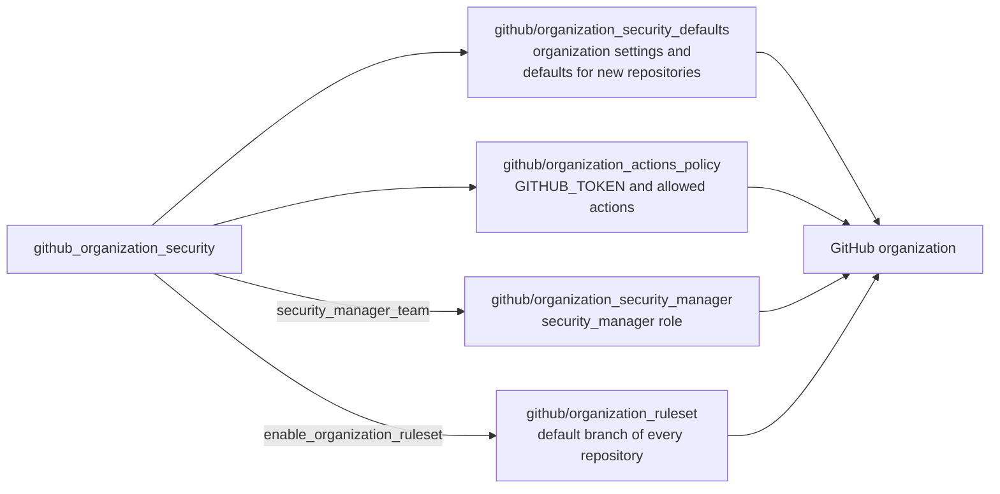

# GitHub Organization Security

This scenario applies the organization-scope recommendations reported by
`ghqr list-recommendations --scope organization` to one GitHub organization.
Each building block is a separate module and can be turned off.

## Architecture



## Managed resources

When `organization` is set, the scenario manages up to six resources.
`github_team` and `github_organization_ruleset` create new objects in GitHub.
The other resources overwrite settings of the existing organization.
When `organization` is `null`, the scenario manages nothing.

| # | Resource | Managed when | What it does | Module |
|---|----------|--------------|--------------|--------|
| 1 | `github_organization_settings` | `enable_security_defaults = true` (default) | Overwrites organization settings and defaults for new repositories | `organization_security_defaults` |
| 2 | `github_actions_organization_workflow_permissions` | `enable_actions_policy = true` (default) | Sets the default `GITHUB_TOKEN` permission and whether Actions can approve pull requests | `organization_actions_policy` |
| 3 | `github_actions_organization_permissions` | `enable_actions_policy = true` (default) | Sets which repositories can run Actions and which actions are allowed | `organization_actions_policy` |
| 4 | `github_team` | `security_manager_team.create = true` | Creates a team for security managers | `organization_security_manager` |
| 5 | `github_organization_role_team` | `security_manager_team` is set | Assigns the `security_manager` role to the team | `organization_security_manager` |
| 6 | `github_organization_ruleset` | `enable_organization_ruleset = true` | Creates a branch ruleset for the default branch of matching repositories | `organization_ruleset` |

When `security_manager_team` is set, the scenario also reads the
`github_organization_roles` data source to look up the `security_manager` role ID.
The data source creates nothing, but it needs the `admin:org` scope
(see [Troubleshooting](#troubleshooting)).

The example in [How to use](#how-to-use) manages resources 1 to 5 and does not create
the organization ruleset.

### Organization settings

`github_organization_settings` applies these values. Override them with
`security_defaults`. The `*_for_new_repositories` settings apply **only to
repositories created after apply**. Existing repositories are not changed.

| Setting | Default | Description | ghqr |
|---------|---------|-------------|------|
| `default_repository_permission` | `read` | Base permission that every organization member has on every repository. Accepts `none`, `read`, or `write`; this scenario rejects `admin`. With `none`, only permissions granted through teams or individual repositories apply. | org-sec-003 |
| `members_can_create_repositories` | `true` | Whether members can create repositories. With `false`, only organization owners can create them. | - |
| `members_can_create_public_repositories` | `false` | Whether members can create public repositories. Disabled by default to prevent accidental exposure of code. | org-sec-004 |
| `members_can_create_private_repositories` | `true` | Whether members can create private repositories. | - |
| `members_can_create_public_pages` | `false` | Whether members can publish public GitHub Pages sites. | - |
| `members_can_fork_private_repositories` | `false` | Whether members can fork private repositories. Disabling it prevents copies of code that are hard to manage. | - |
| `web_commit_signoff_required` | `true` | Whether commits made in the GitHub web UI require the author's sign-off (a `Signed-off-by` trailer). | org-sec-002 |
| `advanced_security_enabled_for_new_repositories` | `false` | Whether GitHub Advanced Security is enabled automatically for new repositories. Disabled by default because it needs a license. | org-def-006 |
| `dependabot_alerts_enabled_for_new_repositories` | `true` | Whether Dependabot creates alerts when a dependency has a known vulnerability. Needs the dependency graph. | org-def-001 |
| `dependabot_security_updates_enabled_for_new_repositories` | `true` | Whether Dependabot automatically opens pull requests that update vulnerable dependencies to a fixed version. Needs Dependabot alerts. | org-def-002 |
| `dependency_graph_enabled_for_new_repositories` | `true` | Whether dependencies are analyzed from manifests and lock files. Dependabot alerts depend on it. | org-def-003 |
| `secret_scanning_enabled_for_new_repositories` | `true` | Whether secrets such as tokens and passwords committed to repositories are detected. Private repositories need GitHub Secret Protection. | org-def-004 |
| `secret_scanning_push_protection_enabled_for_new_repositories` | `true` | Whether pushes that contain secrets are blocked. Needs secret scanning. | org-def-005 |

The scenario does not pass the organization display name or description.
Settings that the scenario does not pass may be reset to the provider defaults on apply.

### GitHub Actions policy

The two Actions resources apply these values. Override the configurable values with
`actions_policy`.

| Setting | Default | Configurable | Description |
|---------|---------|--------------|-------------|
| `default_workflow_permissions` | `read` | Yes | Default permission granted to `GITHUB_TOKEN` in workflows. `read` allows only reading repository contents and packages; `write` allows reading and writing every scope. Workflows that need write access should grant only the required permissions with the `permissions` key. |
| `can_approve_pull_request_reviews` | `false` | Yes | Whether GitHub Actions can approve pull requests. Allowing it lets workflows approve changes automatically and bypass review requirements. |
| `enabled_repositories` | `all` | No | Repositories that can run Actions. This scenario always uses `all` (every repository). |
| `allowed_actions` | `selected` | Yes | Actions and reusable workflows allowed to run. `all` allows everything; `local_only` allows only those defined in repositories of the organization; `selected` allows those plus the ones permitted by the next three settings. |
| `github_owned_allowed` | `true` | No | Whether actions created by GitHub (such as `actions/*` and `github/*`) are allowed. |
| `verified_allowed` | `true` | Yes | Whether actions published by verified creators in GitHub Marketplace are allowed. |
| `patterns_allowed` | `[]` | Yes | Additional action patterns to allow, such as `owner/repo@*`, `owner/repo@v2`, or `owner/*`. Tags, SHAs, and wildcards are allowed. Example: `hashicorp/setup-terraform@*`. |
| `sha_pinning_required` | `false` | Yes | Whether actions and reusable workflows must be referenced by a full commit SHA. When enabled, workflows that reference a tag such as `@v4` cannot run. |

`github_owned_allowed`, `verified_allowed`, and `patterns_allowed` apply only when
`allowed_actions = "selected"`.

### Security manager team

`security_manager_team` accepts these values.

| Setting | Default | Description |
|---------|---------|-------------|
| `slug` | None (required) | Slug of the team that receives the role. With `create = true`, it is also used as the team name. Use a lowercase, hyphenated name so that the slug matches the name. |
| `create` | `false` | `true` creates the team; `false` uses an existing team. |
| `description` | `Security managers (managed by Terraform)` | Description of the team created with `create = true`. |

| `security_manager_team.create` | Result |
|--------------------------------|--------|
| `false` (default) | Assigns the role to an existing team whose slug is `security_manager_team.slug`. The team must already exist. |
| `true` | Creates a team named `security_manager_team.slug`, then assigns the role to it. Its privacy is `closed` (visible to every organization member). |

The `security_manager` role gives team members read access to every repository,
write access to security alerts, and access to security settings in the organization.
This scenario does not manage team membership.

### Organization ruleset

`github_organization_ruleset` targets branches and applies these values.
Override them with `organization_ruleset`. `rules.*` are attributes of
`organization_ruleset.rules`.

| Setting | Default | Description |
|---------|---------|-------------|
| `name` | `org-default-branch-protection` | Name of the ruleset shown in the organization settings. |
| `enforcement` | `active` | `active` enforces the rules. `evaluate` records results in rule insights without enforcing them (Enterprise only). `disabled` turns the rules off. |
| `repository_name_include` | `["~ALL"]` | Repository name patterns to target. `~ALL` means every repository. |
| `repository_name_exclude` | `[]` | Repository name patterns to exclude. |
| Target branches | `~DEFAULT_BRANCH` | The default branch of each repository. Not configurable in this scenario. |
| `bypass_actors` | `[]` | Actors that can bypass the rules. `actor_type` is one of `OrganizationAdmin`, `RepositoryRole`, `Team`, `Integration`, `DeployKey`, or `EnterpriseOwner`. `bypass_mode` is `pull_request` (default; bypass only through pull requests), `always` (always bypass), or `exempt` (the rules do not apply). Omit `actor_id` for `OrganizationAdmin`, `EnterpriseOwner`, and `DeployKey`. |
| `rules.required_approving_review_count` | `2` | Number of approvals required before merging, from 0 to 10. |
| `rules.dismiss_stale_reviews_on_push` | `true` | Whether existing approvals are dismissed when new commits are pushed. |
| `rules.require_code_owner_review` | `true` | Whether changes to files with code owners in `CODEOWNERS` require approval from a code owner. |
| `rules.require_last_push_approval` | `true` | Whether the most recent push must be approved by someone other than the person who pushed it. |
| `rules.required_review_thread_resolution` | `true` | Whether merging is blocked until every review comment thread is resolved. |
| `rules.allowed_merge_methods` | `["squash", "rebase"]` | Allowed merge methods; at least one of `merge`, `squash`, or `rebase`. When `required_linear_history` is enabled, `merge` cannot be used because it creates merge commits. |
| `rules.non_fast_forward` | `true` | Whether force pushes are blocked. |
| `rules.deletion` | `true` | Whether branch deletion is blocked. Only actors in `bypass_actors` can delete the branch. |
| `rules.required_signatures` | `true` | Whether only commits with verified signatures (GPG, SSH, or S/MIME) can be pushed. Developers without signing configured cannot push. |
| `rules.required_linear_history` | `true` | Whether pushing merge commits is blocked. |
| `rules.required_status_checks` | `[]` | Status checks that must pass before merging. Each item has `context` (the check name) and an optional `integration_id` (the ID of the GitHub App that reports the check). When empty, this rule is not created. |
| `rules.strict_required_status_checks_policy` | `true` | Whether checks must pass on a branch that is up to date with the base branch. Applies only when `required_status_checks` is set. |
| `rules.required_code_scanning` | `[]` | Code scanning results required before merging. Each item has `tool` (default `CodeQL`), `alerts_threshold` (default `errors`; `none`, `errors`, `errors_and_warnings`, or `all`), and `security_alerts_threshold` (default `high_or_higher`; `none`, `critical`, `high_or_higher`, `medium_or_higher`, or `all`). Alerts at or above the threshold block merging. When empty, this rule is not created. |

Organization rulesets need GitHub Team or Enterprise, and `evaluate` enforcement
needs Enterprise.

## ghqr rule mapping

| ghqr | Setting | Module |
|------|---------|--------|
| org-def-001 | Dependabot alerts for new repositories | `organization_security_defaults` |
| org-def-002 | Dependabot security updates for new repositories | `organization_security_defaults` |
| org-def-003 | Dependency graph for new repositories | `organization_security_defaults` |
| org-def-004 | Secret scanning for new repositories | `organization_security_defaults` |
| org-def-005 | Push protection for new repositories | `organization_security_defaults` |
| org-def-006 | GitHub Advanced Security for new repositories (off by default; needs a license) | `organization_security_defaults` |
| org-sec-002 | Web commit sign-off required | `organization_security_defaults` |
| org-sec-003 | Base permission `read` (`admin` is rejected) | `organization_security_defaults` |
| org-sec-004 | Members cannot create public repositories | `organization_security_defaults` |
| org-act-001 | Read-only `GITHUB_TOKEN`, Actions cannot approve pull requests | `organization_actions_policy` |
| org-act-002, 003 | `selected` actions: GitHub-owned, verified creators, and `patterns_allowed` | `organization_actions_policy` |
| org-sec-005 | `security_manager` role assigned to a team | `organization_security_manager` |
| repo-bp-* (organization-wide) | Optional organization ruleset on `~DEFAULT_BRANCH` of `~ALL` repositories | `organization_ruleset` |

The provider cannot configure these rules:

| ghqr | Reason |
|------|--------|
| org-sec-001 | Requiring two-factor authentication is not exposed by the GitHub API |
| org-sec-006 | Informational for Enterprise Managed Users |
| org-def-007 | The provider has no setting for private vulnerability reporting on new repositories |
| org-cop-* | Copilot policies and seats are not managed by the provider |
| org-alert-* | Open alerts must be remediated, not configured |

## Prerequisites

- Meet the prerequisites of the [Terraform workflow](../../../docs/tips/terraform-workflow.md).
- Configure `GITHUB_TOKEN` for an organization owner by following
  [provider authentication](../../../docs/tips/provider-authentication.md#github).
  A classic token needs the `admin:org` scope.
- `github_organization_settings` manages **every** organization setting. Arguments
  that this scenario does not pass are reset to the provider defaults on apply.
  Review the plan carefully before applying it to an existing organization.
- Organization rulesets need GitHub Team or Enterprise. `evaluate` enforcement needs Enterprise.

## How to use

Create `infra/scenarios/github_organization_security/terraform.tfvars`.
The file is ignored by Git.

```hcl
organization  = "your-org"
billing_email = "billing@example.com"

security_defaults = {
  # Enable only when the organization has GitHub Advanced Security licenses.
  advanced_security_enabled_for_new_repositories = false
}

actions_policy = {
  patterns_allowed = ["hashicorp/setup-terraform@*"]
}

security_manager_team = {
  slug   = "security-managers"
  create = true
}

enable_organization_ruleset = false
organization_ruleset = {
  enforcement   = "evaluate"
  bypass_actors = [{ actor_type = "OrganizationAdmin", bypass_mode = "always" }]
}
```

Then run from the repository root:

```bash
export GITHUB_TOKEN=$(gh auth token)
make init SCENARIO=github_organization_security
make plan SCENARIO=github_organization_security
make deploy SCENARIO=github_organization_security
```

Verify the result with ghqr:

```bash
./ghqr scan -o your-org
```

Organization rulesets are disabled in this example to avoid plan restrictions.
To enable them on GitHub Team, set `enable_organization_ruleset = true` and
`enforcement = "active"`. On Enterprise, you can start with `enforcement = "evaluate"`
to review the impact in rule insights before switching to `active`.

## Troubleshooting

### `GET /orgs/{org}/organization-roles` returns `404 Not Found`

When `security_manager_team` is set, the security manager module calls this API
to look up the `security_manager` role. GitHub can return 404 for insufficient
access, not just for a nonexistent organization.

The authenticated account must be an organization owner to assign the role.
For a classic PAT or a GitHub CLI OAuth token, the
[organization roles API](https://docs.github.com/en/rest/orgs/organization-roles#get-all-organization-roles-for-an-organization)
requires `admin:org`; `read:org` is insufficient even when the account is an owner.

For a stored GitHub CLI login, run the following from the repository root,
replacing `your-org` with your organization login. Clear token environment
variables so they do not override the stored login, then export the refreshed
token again for Terraform.

```bash
unset GH_TOKEN GITHUB_TOKEN
gh auth refresh --hostname github.com --scopes admin:org
export GITHUB_TOKEN="$(gh auth token --hostname github.com)"

GH_TOKEN="$GITHUB_TOKEN" gh api orgs/your-org/organization-roles --jq '.roles[].name'
make plan SCENARIO=github_organization_security
```

If you use a separately issued classic PAT instead, add `admin:org` to that token
and update `GITHUB_TOKEN`. Do not write the token to Terraform files.
If the API still returns 404, verify the organization login and the authenticated
account's owner access, and authorize the token for SAML SSO if required.

### `POST /orgs/{org}/rulesets` returns `403 Upgrade to GitHub Team`

This error indicates a plan restriction, not a missing token scope.
Organization rulesets require GitHub Team or Enterprise, and `evaluate`
enforcement requires Enterprise.

On GitHub Free, set the following in your existing
`infra/scenarios/github_organization_security/terraform.tfvars` to skip ruleset
creation:

```hcl
enable_organization_ruleset = false
```

The variable default and the example above are already `false`, but updating
this README does not change an existing `terraform.tfvars` that sets it to `true`.
Run `make plan SCENARIO=github_organization_security` from the repository root
and confirm that no organization ruleset will be created before deploying again.
If a ruleset is already managed in state, disabling it plans its removal; review
the plan before applying.

## Variables

| Name | Type | Description | Default |
|------|------|-------------|---------|
| `organization` | `string` | Organization login; `null` manages nothing | `null` |
| `billing_email` | `string` | Billing email; required when `enable_security_defaults` is true | `null` |
| `enable_security_defaults` | `bool` | Manage organization settings and new repository defaults | `true` |
| `security_defaults` | `object` | Overrides for `organization_security_defaults`; omitted values use the module defaults. See [Organization settings](#organization-settings) | `{}` |
| `enable_actions_policy` | `bool` | Manage the organization Actions policy | `true` |
| `actions_policy` | `object` | `default_workflow_permissions`, `can_approve_pull_request_reviews`, `allowed_actions`, `patterns_allowed`, `verified_allowed`, `sha_pinning_required`. See [GitHub Actions policy](#github-actions-policy) | `{}` |
| `security_manager_team` | `object` | `slug`, `create`, `description` of the security manager team; `null` skips it. See [Security manager team](#security-manager-team) | `null` |
| `enable_organization_ruleset` | `bool` | Create the organization ruleset | `false` |
| `organization_ruleset` | `object` | `name`, `enforcement`, `repository_name_include`, `repository_name_exclude`, `bypass_actors`, `rules`. See [Organization ruleset](#organization-ruleset) | `{}` |

## Outputs

| Name | Description |
|------|-------------|
| `organization` | Organization login, or `null` |
| `security_defaults` | Applied organization security settings, or `null` |
| `actions_default_workflow_permissions` | Default `GITHUB_TOKEN` permission, or `null` |
| `actions_allowed_actions` | Allowed actions policy, or `null` |
| `security_manager_team_slug` | Team assigned the security manager role, or `null` |
| `organization_ruleset_name` | Organization ruleset name, or `null` |

## Offline tests

The tests use a mock GitHub provider and `command = plan`.
They need no credentials and make no GitHub API calls.

```bash
export TF_DATA_DIR=$(mktemp -d)
terraform -chdir=infra/scenarios/github_organization_security init -backend=false -lockfile=readonly -input=false
terraform -chdir=infra/scenarios/github_organization_security validate
terraform -chdir=infra/scenarios/github_organization_security test
```

The `test-github-mock` job in [CI](../../../.github/workflows/test.yml) runs the same checks.
This scenario is not part of the live `test-github` job because it needs organization owner rights.
