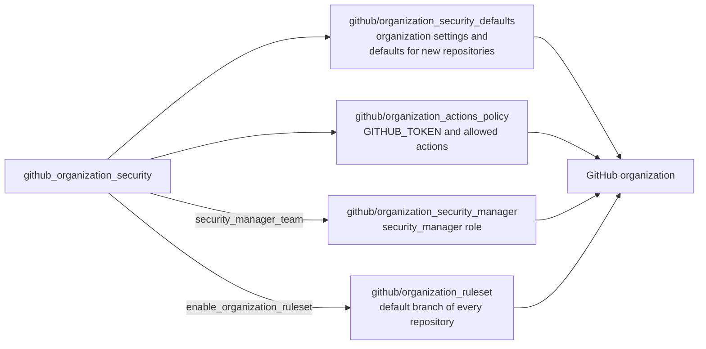

# GitHub Organization Security

This scenario applies the organization-scope recommendations reported by
`ghqr list-recommendations --scope organization` to one GitHub organization.
Each building block is a separate module and can be turned off.

## Architecture



## ghqr rule mapping

| ghqr | Setting | Module |
|------|---------|--------|
| org-def-001 | Dependabot alerts for new repositories | `organization_security_defaults` |
| org-def-002 | Dependabot security updates for new repositories | `organization_security_defaults` |
| org-def-003 | Dependency graph for new repositories | `organization_security_defaults` |
| org-def-004 | Secret scanning for new repositories | `organization_security_defaults` |
| org-def-005 | Push protection for new repositories | `organization_security_defaults` |
| org-def-006 | GitHub Advanced Security for new repositories (off by default; needs a license) | `organization_security_defaults` |
| org-sec-002 | Web commit sign-off required | `organization_security_defaults` |
| org-sec-003 | Base permission `read` (`admin` is rejected) | `organization_security_defaults` |
| org-sec-004 | Members cannot create public repositories | `organization_security_defaults` |
| org-act-001 | Read-only `GITHUB_TOKEN`, Actions cannot approve pull requests | `organization_actions_policy` |
| org-act-002, 003 | `selected` actions: GitHub-owned, verified creators, and `patterns_allowed` | `organization_actions_policy` |
| org-sec-005 | `security_manager` role assigned to a team | `organization_security_manager` |
| repo-bp-* (organization-wide) | Optional organization ruleset on `~DEFAULT_BRANCH` of `~ALL` repositories | `organization_ruleset` |

The provider cannot configure these rules:

| ghqr | Reason |
|------|--------|
| org-sec-001 | Requiring two-factor authentication is not exposed by the GitHub API |
| org-sec-006 | Informational for Enterprise Managed Users |
| org-def-007 | The provider has no setting for private vulnerability reporting on new repositories |
| org-cop-* | Copilot policies and seats are not managed by the provider |
| org-alert-* | Open alerts must be remediated, not configured |

## Prerequisites

- Meet the prerequisites of the [Terraform workflow](../../../docs/tips/terraform-workflow.md).
- Configure `GITHUB_TOKEN` for an organization owner by following
  [provider authentication](../../../docs/tips/provider-authentication.md#github).
  A classic token needs the `admin:org` scope.
- `github_organization_settings` manages **every** organization setting. Arguments
  that this scenario does not pass are reset to the provider defaults on apply.
  Review the plan carefully before applying it to an existing organization.
- Organization rulesets need GitHub Team or Enterprise. `evaluate` enforcement needs Enterprise.

## How to use

Create `infra/scenarios/github_organization_security/terraform.tfvars`.
The file is ignored by Git.

```hcl
organization  = "your-org"
billing_email = "billing@example.com"

security_defaults = {
  # Enable only when the organization has GitHub Advanced Security licenses.
  advanced_security_enabled_for_new_repositories = false
}

actions_policy = {
  patterns_allowed = ["hashicorp/setup-terraform@*"]
}

security_manager_team = {
  slug   = "security-managers"
  create = true
}

enable_organization_ruleset = true
organization_ruleset = {
  enforcement   = "evaluate"
  bypass_actors = [{ actor_id = 1, actor_type = "OrganizationAdmin", bypass_mode = "always" }]
}
```

Then run from the repository root:

```bash
export GITHUB_TOKEN=$(gh auth token)
make init SCENARIO=github_organization_security
make plan SCENARIO=github_organization_security
make deploy SCENARIO=github_organization_security
```

Verify the result with ghqr:

```bash
./ghqr scan -o your-org
```

Start the organization ruleset with `enforcement = "evaluate"` to review its impact
in rule insights before switching to `active`.

## Variables

| Name | Type | Description | Default |
|------|------|-------------|---------|
| `organization` | `string` | Organization login; `null` manages nothing | `null` |
| `billing_email` | `string` | Billing email; required when `enable_security_defaults` is true | `null` |
| `enable_security_defaults` | `bool` | Manage organization settings and new repository defaults | `true` |
| `security_defaults` | `object` | Overrides for `organization_security_defaults`; omitted values use the module defaults | `{}` |
| `enable_actions_policy` | `bool` | Manage the organization Actions policy | `true` |
| `actions_policy` | `object` | `default_workflow_permissions`, `can_approve_pull_request_reviews`, `allowed_actions`, `patterns_allowed`, `verified_allowed`, `sha_pinning_required` | `{}` |
| `security_manager_team` | `object` | `slug`, `create`, `description` of the security manager team; `null` skips it | `null` |
| `enable_organization_ruleset` | `bool` | Create the organization ruleset | `false` |
| `organization_ruleset` | `object` | `name`, `enforcement`, `repository_name_include`, `repository_name_exclude`, `bypass_actors`, `rules` | `{}` |

## Outputs

| Name | Description |
|------|-------------|
| `organization` | Organization login, or `null` |
| `security_defaults` | Applied organization security settings, or `null` |
| `actions_default_workflow_permissions` | Default `GITHUB_TOKEN` permission, or `null` |
| `actions_allowed_actions` | Allowed actions policy, or `null` |
| `security_manager_team_slug` | Team assigned the security manager role, or `null` |
| `organization_ruleset_name` | Organization ruleset name, or `null` |

## Offline tests

The tests use a mock GitHub provider and `command = plan`.
They need no credentials and make no GitHub API calls.

```bash
export TF_DATA_DIR=$(mktemp -d)
terraform -chdir=infra/scenarios/github_organization_security init -backend=false -lockfile=readonly -input=false
terraform -chdir=infra/scenarios/github_organization_security validate
terraform -chdir=infra/scenarios/github_organization_security test
```

The `test-github-mock` job in [CI](../../../.github/workflows/test.yml) runs the same checks.
This scenario is not part of the live `test-github` job because it needs organization owner rights.
