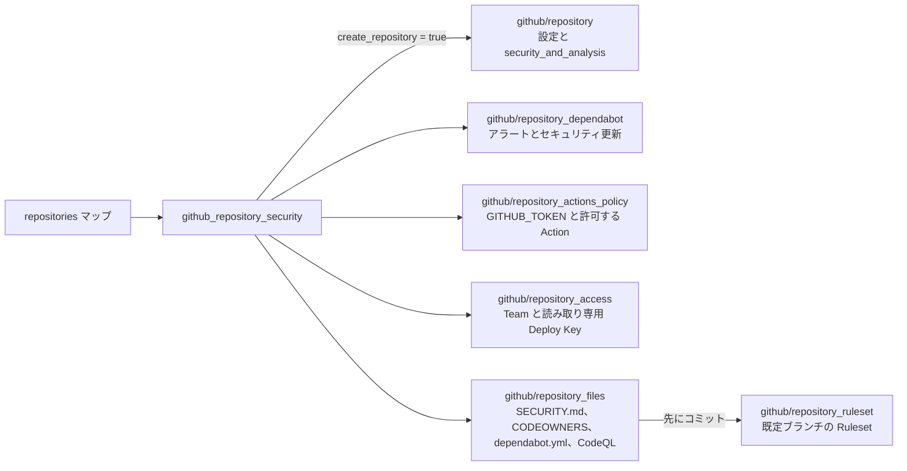

# GitHub Repository Security

`ghqr list-recommendations --scope repository` が示すリポジトリ単位の推奨事項を、
1 つ以上のリポジトリに適用します。`repositories` マップの各リポジトリに同じ再利用可能な
部品を適用し、部品ごとに無効化できます。

- `create_repository = true` の場合、セキュリティと分析の設定を含めてリポジトリを作成します。
- `create_repository = false` の場合、`github_repository` 自体は管理せずに既存リポジトリを強化します。

## アーキテクチャ



Ruleset は作成後に既定ブランチへの Pull Request を必須にするため、コミットするファイルに依存させています。

## ghqr ルールとの対応

| ghqr | 設定 | モジュール |
|------|------|------------|
| repo-bp-001, repo-bp-014 | `~DEFAULT_BRANCH` に `active` の Ruleset | `repository_ruleset` |
| repo-bp-002, 003, 006 | 2 件の承認を必須とする Pull Request | `repository_ruleset` |
| repo-bp-004, 005 | 古いレビューの却下、コードオーナーのレビュー必須 | `repository_ruleset` |
| repo-bp-007..009 | 厳格な必須ステータスチェック（`ruleset_rules.required_status_checks` を設定） | `repository_ruleset` |
| repo-bp-010..013 | Force push と削除の禁止、署名付きコミットと直線的な履歴の必須化 | `repository_ruleset` |
| repo-sec-001 | Dependabot アラート | `repository_dependabot` |
| repo-sec-007 | Dependabot セキュリティ更新と `dependabot.yml` | `repository_dependabot`、`repository_files` |
| repo-sec-004 | `SECURITY.md` | `repository_files` |
| repo-sec-005 | `.github/CODEOWNERS` | `repository_files` |
| repo-sec-006 | `.github/dependabot.yml`（`github-actions` と `dependabot_ecosystems`） | `repository_files` |
| repo-sec-008 | `.github/workflows/codeql.yml` | `repository_files` |
| repo-sec-009 | `.github/codeql/codeql-config.yml`（`security-extended` クエリ） | `repository_files` |
| repo-acc-001, 002 | 直接のコラボレーターではなく `team_permissions` でアクセスを付与 | `repository_access` |
| repo-acc-003..005 | Deploy Key は常に読み取り専用。GitHub App や OIDC を推奨 | `repository_access` |
| repo-feat-001, repo-comm-001 | Issues と Discussions の有効化 | `repository` |
| repo-feat-002 | マージ後の head ブランチ自動削除 | `repository` |
| repo-meta-001, 002 | 説明とトピック | `repository` |
| (GHAS) | シークレットスキャンとプッシュ保護 | `repository` |
| (リポジトリ単位の org-act-001..003) | 読み取り専用の `GITHUB_TOKEN`、選択した Action のみ許可 | `repository_actions_policy` |

repo-sec-002、repo-sec-003（未解決の Dependabot アラート）と repo-meta-003（休眠リポジトリ）は
プロバイダーで設定できないため、運用で対応してください。
プロバイダーは CodeQL の default setup に対応していないため、advanced setup のワークフローをコミットします。

## 前提条件

- [Terraform ワークフロー](../../../docs/tips/terraform-workflow.ja.md)の前提条件を満たします。
- [プロバイダー認証](../../../docs/tips/provider-authentication.ja.md#github)に従って `GITHUB_TOKEN` を設定します。
  classic token には `repo` と `workflow` スコープが必要です（後者は CodeQL ワークフローのコミットに使用）。
  Organization のリポジトリで `team_permissions` を使う場合は `read:org` も必要です。
- Public リポジトリではシークレットスキャンと CodeQL を無料で利用できます。Private と Internal の
  リポジトリでは GitHub Secret Protection と Code Security のライセンスが必要です。ない場合は
  `manage_security_and_analysis = false` と `codeql_workflow = false` を設定してください。
- 既定の Ruleset は 2 件の承認、コードオーナーのレビュー、署名付きコミットを必須にします。
  メンテナーが少ないリポジトリでは `ruleset_rules.required_approving_review_count` を下げてください。

## 使用方法

`infra/scenarios/github_repository_security/terraform.tfvars` を作成します。
このファイルは Git 管理外です。
次の例は、このシナリオで設定できる中で最も厳しい構成を Public リポジトリに適用します。

```hcl
github_owner = "your-org-or-user"

# 単独メンテナーの場合、2 件の承認とコードオーナーのレビューを満たせず、PR をマージできません。
# 運用に合わせて ruleset_rules や ruleset_bypass_actors を緩めてください。
repositories = {
  "secure-sample" = {
    create_repository = true
    description       = "Public repository hardened with the strictest ghqr baseline"
    visibility        = "public"
    topics            = ["security", "terraform"]
    has_issues        = true
    has_discussions   = true

    # Public リポジトリでは advanced_security と code_security を指定できない（常に有効）。
    # Non-provider patterns と AI 検出には GitHub Secret Protection が必要なため指定しない。
    manage_security_and_analysis = true
    security_and_analysis = {
      secret_scanning                 = "enabled"
      secret_scanning_push_protection = "enabled"
    }

    # Dependabot アラートとセキュリティ更新、github-actions の定期更新
    dependabot_enabled = true
    dependabot_file    = true
    # リポジトリで使うエコシステムを追加する（例: { package_ecosystem = "pip", directory = "/" }）
    dependabot_ecosystems = []

    # CodeQL（security-extended クエリ）。コードを追加したら言語を追加する（例: "python"）。
    codeql_workflow  = true
    codeql_languages = ["actions"]

    # 既定ブランチの Ruleset。バイパスは許可しない。
    ruleset_enabled       = true
    ruleset_bypass_actors = []
    ruleset_rules = {
      required_approving_review_count   = 2
      dismiss_stale_reviews_on_push     = true
      require_code_owner_review         = true
      require_last_push_approval        = true
      required_review_thread_resolution = true
      # 署名付きコミット必須の場合、GitHub の rebase merge は使えないため squash のみ許可する。
      allowed_merge_methods = ["squash"]
      # codeql_languages を増やしたら "Analyze (<language>)" も追加する。
      required_status_checks               = [{ context = "Analyze (actions)" }]
      strict_required_status_checks_policy = true
      required_code_scanning = [{
        tool                      = "CodeQL"
        alerts_threshold          = "all"
        security_alerts_threshold = "all"
      }]
      non_fast_forward        = true
      deletion                = true
      required_signatures     = true
      required_linear_history = true
    }

    # 読み取り専用の GITHUB_TOKEN、GitHub 製と検証済み作成者の Action のみ許可
    actions_policy_enabled = true
    manage_allowed_actions = true
    actions_patterns       = []

    # Team は Organization 専用。Deploy Key は作成しない。
    team_permissions = {}
    deploy_keys      = {}

    # SECURITY.md（連絡先が null の場合は非公開の脆弱性報告へのリンク）と CODEOWNERS
    security_policy_file = true
    security_contact     = null
    codeowners_file      = true
    codeowners           = ["@your-org-or-user"]

    overwrite_files = false
  }
}
```

リポジトリのルートで実行します。

```bash
export GITHUB_TOKEN=$(gh auth token)
make init SCENARIO=github_repository_security
make plan SCENARIO=github_repository_security
make deploy SCENARIO=github_repository_security
```

ghqr で結果を確認します。

```bash
./ghqr scan -r your-org-or-user/secure-sample
```

### 注意事項

- `create_repository = false` の場合、`security_and_analysis`、説明、トピックは管理しません。
  管理する場合は `terraform import 'module.repository["<name>"].github_repository.this' <name>` で
  リポジトリをインポートし、`create_repository = true` を設定してください。
- `overwrite_files = true` にしない限り、既存のファイルは上書きしません。
- Ruleset の作成後に Terraform でファイルを更新するには、Ruleset のバイパスが必要です。
  そのトレードオフを受け入れる場合に限り、`{ actor_id = 5, actor_type = "RepositoryRole", bypass_mode = "always" }`
  （リポジトリ管理者）などのバイパスアクターを追加してください。
- `repository_actions_policy` はリポジトリで許可する Action のポリシーを管理します。Organization の
  ポリシーですでに制限している場合は `manage_allowed_actions = false` を設定してください。
- 作成したリポジトリを destroy すると、削除せずにアーカイブします。

## トラブルシューティング

### `.github/workflows/codeql.yml` のコミットで `404 Not Found` になる

```text
Error: PUT https://api.github.com/repos/<owner>/<repo>/contents/.github/workflows/codeql.yml: 404 Not Found []
```

`.github/workflows/` 配下のファイルを作成・更新するには `workflow` スコープが必要です。
トークンにこのスコープがない場合、GitHub は `403` ではなく `404` を返します。スコープを追加して
トークンを設定し直し、`make deploy` を再実行してください。Ruleset はファイルの後に作成するため、
再実行でデプロイが完了します。

```bash
gh auth refresh -h github.com -s workflow
export GITHUB_TOKEN=$(gh auth token)
```

### `422 Secret scanning is not available for this repository` になる

```text
Error: PATCH https://api.github.com/repos/<owner>/<repo>: 422 Secret scanning is not available for this repository. []
```

`visibility` の既定値は `private` で、Private リポジトリでシークレットスキャンを使うには
GitHub Secret Protection のライセンスが必要です。`repositories` の各エントリ間で設定は共有されないため、
Public にするリポジトリごとに `visibility = "public"` を設定してください。Private のまま使う場合は
`manage_security_and_analysis = false` と `codeql_workflow = false` を設定してください。

### Terraform 外で削除したリポジトリの読み取りで `404 Not Found` になる

```text
Error: repository doesn't exist anymore, please remove the resource from your configuration: GET https://api.github.com/repos/<owner>/<repo>: 404 Not Found []
Error: GET https://api.github.com/repos/<owner>/<repo>/actions/permissions: 404 Not Found []
```

GitHub から取得できないリポジトリを state が参照しています。トークンがリポジトリにアクセスできない場合も
GitHub は `404` を返すため、まず `gh repo view <owner>/<repo>` で確認してください。
リポジトリが削除済みであれば、state をバックアップしてから、そのリポジトリのリソースを state から除去し、
`make plan` で再作成内容を確認してください。

```bash
dir=infra/scenarios/github_repository_security
terraform -chdir="$dir" state pull > github_repository_security.tfstate.bak
terraform -chdir="$dir" state list | grep -F '["<repo>"]' | while IFS= read -r address; do
  terraform -chdir="$dir" state rm "$address"
done
```

## 変数

| 名前 | 型 | 説明 | 既定値 |
|------|------|------|--------|
| `github_owner` | `string` | リポジトリを所有する GitHub ユーザーまたは Organization | `"ks6088ts"` |
| `repositories` | `map(object)` | リポジトリ名をキーとするマップ。属性は下表を参照 | `{}` |

`repositories` の主な属性（省略した値はモジュールの既定値を使用）:

| 属性 | 既定値 | 説明 |
|------|--------|------|
| `create_repository` | `true` | リポジトリを作成するか、既存リポジトリを強化するか |
| `default_branch` | `"main"` | push 時に CodeQL を実行するブランチ |
| `description`、`topics` | ベースラインの説明文、`["security", "terraform"]` | リポジトリのメタデータ |
| `visibility` | `private` | `private`、`internal`、`public` |
| `manage_security_and_analysis`、`security_and_analysis` | `true`、シークレットスキャンとプッシュ保護を有効化 | GHAS 機能の状態 |
| `dependabot_enabled` | `true` | Dependabot アラートとセキュリティ更新 |
| `ruleset_enabled`、`ruleset_rules`、`ruleset_bypass_actors` | `true`、安全な既定値、`[]` | 既定ブランチの Ruleset |
| `actions_policy_enabled`、`manage_allowed_actions`、`actions_patterns` | `true`、`true`、`[]` | 読み取り専用トークンと選択した Action のみ許可 |
| `team_permissions`、`deploy_keys` | `{}` | Team のアクセスと読み取り専用 Deploy Key |
| `security_policy_file`、`security_contact` | `true`、`null` | `SECURITY.md`。連絡先がなければ非公開の脆弱性報告へのリンク |
| `codeowners_file`、`codeowners` | `true`、`["@<github_owner>"]` | `.github/CODEOWNERS` |
| `dependabot_file`、`dependabot_ecosystems` | `true`、`[]` | `.github/dependabot.yml` |
| `codeql_workflow`、`codeql_languages` | `true`、`["actions"]` | CodeQL のワークフローと設定 |
| `overwrite_files` | `false` | 初回の管理時に既存ファイルを上書きするか |

## 出力

| 名前 | 説明 |
|------|------|
| `repositories` | リポジトリごとの作成有無、フルネーム、適用した部品 |

## オフラインテスト

シナリオとモジュールのテストは mock GitHub provider と `command = plan` を使用します。
資格情報は不要で、GitHub API を呼び出しません。

```bash
export TF_DATA_DIR=$(mktemp -d)
terraform -chdir=infra/scenarios/github_repository_security init -backend=false -lockfile=readonly -input=false
terraform -chdir=infra/scenarios/github_repository_security validate
terraform -chdir=infra/scenarios/github_repository_security test
```

[CI](../../../.github/workflows/test.yml) の `test-github-mock` job は同じ確認と、
`repository` および `repository_ruleset` モジュールのテストを実行します。
このシナリオはリポジトリを作成するため、実 API を使う `test-github` job には含めていません。
