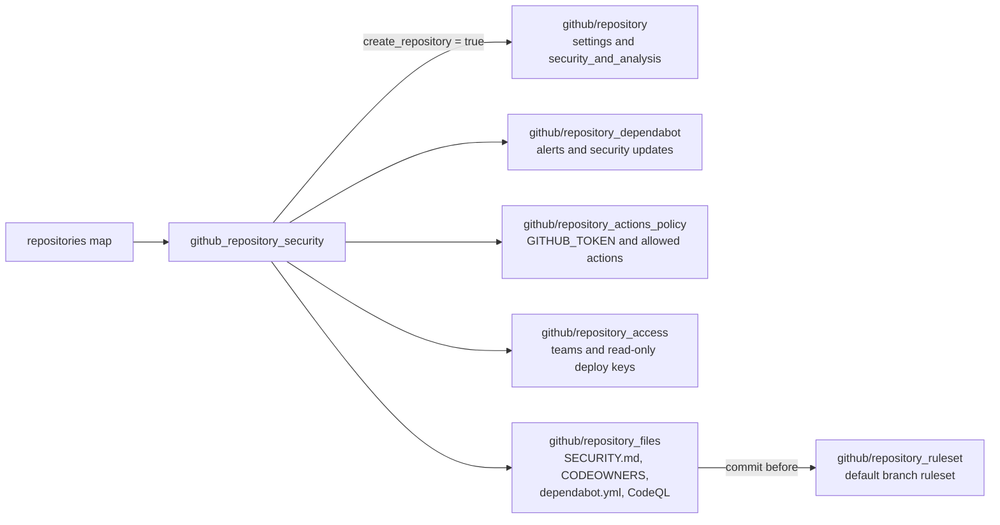

# GitHub Repository Security

This scenario applies the repository-scope recommendations reported by
`ghqr list-recommendations --scope repository` to one or more repositories.
Each repository in the `repositories` map gets the same reusable building blocks,
which can be turned off individually.

- `create_repository = true` creates the repository with security and analysis settings.
- `create_repository = false` hardens an existing repository without managing
  `github_repository` itself.

## Architecture



The ruleset depends on the committed files because it requires pull requests
on the default branch after it is created.

## ghqr rule mapping

| ghqr | Setting | Module |
|------|---------|--------|
| repo-bp-001, repo-bp-014 | Ruleset on `~DEFAULT_BRANCH` with `active` enforcement | `repository_ruleset` |
| repo-bp-002, 003, 006 | Pull requests with 2 approving reviews | `repository_ruleset` |
| repo-bp-004, 005 | Dismiss stale reviews, require code owner review | `repository_ruleset` |
| repo-bp-007..009 | Strict required status checks (set `ruleset_rules.required_status_checks`) | `repository_ruleset` |
| repo-bp-010..013 | Block force pushes and deletion, require signed commits and linear history | `repository_ruleset` |
| repo-sec-001 | Dependabot alerts | `repository_dependabot` |
| repo-sec-007 | Dependabot security updates and `dependabot.yml` | `repository_dependabot`, `repository_files` |
| repo-sec-004 | `SECURITY.md` | `repository_files` |
| repo-sec-005 | `.github/CODEOWNERS` | `repository_files` |
| repo-sec-006 | `.github/dependabot.yml` (`github-actions` plus `dependabot_ecosystems`) | `repository_files` |
| repo-sec-008 | `.github/workflows/codeql.yml` | `repository_files` |
| repo-sec-009 | `.github/codeql/codeql-config.yml` (`security-extended` queries) | `repository_files` |
| repo-acc-001, 002 | Access through `team_permissions` instead of direct collaborators | `repository_access` |
| repo-acc-003..005 | Deploy keys are always read-only; prefer GitHub Apps or OIDC | `repository_access` |
| repo-feat-001, repo-comm-001 | Issues and Discussions enabled | `repository` |
| repo-feat-002 | Delete head branches on merge | `repository` |
| repo-meta-001, 002 | Description and topics | `repository` |
| (GHAS) | Secret scanning and push protection | `repository` |
| (org-act-001..003 at repository level) | Read-only `GITHUB_TOKEN`, selected actions only | `repository_actions_policy` |

The provider cannot configure repo-sec-002, repo-sec-003 (open Dependabot alerts),
or repo-meta-003 (dormant repositories). Resolve them operationally.
CodeQL default setup is not supported by the provider, so this scenario commits
an advanced setup workflow instead.

## Prerequisites

- Meet the prerequisites of the [Terraform workflow](../../../docs/tips/terraform-workflow.md).
- Configure `GITHUB_TOKEN` by following [provider authentication](../../../docs/tips/provider-authentication.md#github).
  A classic token needs the `repo` and `workflow` scopes (the latter to commit the CodeQL workflow).
  `team_permissions` on organization repositories also needs `read:org`.
- Public repositories get secret scanning and CodeQL at no cost. Private and internal
  repositories need GitHub Secret Protection and Code Security licenses; otherwise set
  `manage_security_and_analysis = false` and `codeql_workflow = false`.
- The default ruleset requires 2 approvals, code owner review, and signed commits.
  Lower `ruleset_rules.required_approving_review_count` for repositories with fewer maintainers.

## How to use

Create `infra/scenarios/github_repository_security/terraform.tfvars`.
The file is ignored by Git.

```hcl
github_owner = "your-org-or-user"

repositories = {
  "secure-sample" = {
    description = "Sample repository hardened with the ghqr baseline"
    visibility  = "public"
    codeql_languages = ["actions", "python"]
    dependabot_ecosystems = [
      { package_ecosystem = "pip", directory = "/" },
    ]
    ruleset_rules = {
      # ghqr repo-bp-003 is reported when fewer than 2 approvals are required.
      required_approving_review_count = 1
      required_status_checks          = [{ context = "Analyze (python)" }]
    }
  }

  "existing-repo" = {
    create_repository = false
    overwrite_files   = false
    team_permissions  = { "platform" = "maintain" }
  }
}
```

Then run from the repository root:

```bash
export GITHUB_TOKEN=$(gh auth token)
make init SCENARIO=github_repository_security
make plan SCENARIO=github_repository_security
make deploy SCENARIO=github_repository_security
```

Verify the result with ghqr:

```bash
./ghqr scan -r your-org-or-user/secure-sample
```

### Notes

- `create_repository = false` leaves `security_and_analysis`, description, and topics unmanaged.
  To manage them, import the repository with `terraform import 'module.repository["<name>"].github_repository.this' <name>`
  and set `create_repository = true`.
- Existing files are not overwritten unless `overwrite_files = true`.
- After the ruleset exists, later Terraform file updates must bypass it.
  Add a bypass actor such as `{ actor_id = 5, actor_type = "RepositoryRole", bypass_mode = "always" }` (repository admin)
  only if you accept that trade-off.
- `repository_actions_policy` manages the repository allowed actions policy. Set
  `manage_allowed_actions = false` when an organization policy already restricts actions.
- Destroying a created repository archives it instead of deleting it.

## Variables

| Name | Type | Description | Default |
|------|------|-------------|---------|
| `github_owner` | `string` | GitHub user or organization that owns the repositories | (required) |
| `repositories` | `map(object)` | Repositories keyed by name; see the attributes below | `{}` |

Main `repositories` attributes (omitted values use the module defaults):

| Attribute | Default | Description |
|-----------|---------|-------------|
| `create_repository` | `true` | Create the repository, or harden an existing one |
| `default_branch` | `"main"` | Branch that triggers CodeQL on push |
| `description`, `topics` | baseline text, `["security", "terraform"]` | Repository metadata |
| `visibility` | `private` | `private`, `internal`, or `public` |
| `manage_security_and_analysis`, `security_and_analysis` | `true`, secret scanning and push protection enabled | GHAS feature statuses |
| `dependabot_enabled` | `true` | Dependabot alerts and security updates |
| `ruleset_enabled`, `ruleset_rules`, `ruleset_bypass_actors` | `true`, secure defaults, `[]` | Default branch ruleset |
| `actions_policy_enabled`, `manage_allowed_actions`, `actions_patterns` | `true`, `true`, `[]` | Read-only token and selected actions |
| `team_permissions`, `deploy_keys` | `{}` | Team access and read-only deploy keys |
| `security_policy_file`, `security_contact` | `true`, `null` | `SECURITY.md`; private vulnerability reporting link when no contact |
| `codeowners_file`, `codeowners` | `true`, `["@<github_owner>"]` | `.github/CODEOWNERS` |
| `dependabot_file`, `dependabot_ecosystems` | `true`, `[]` | `.github/dependabot.yml` |
| `codeql_workflow`, `codeql_languages` | `true`, `["actions"]` | CodeQL workflow and config |
| `overwrite_files` | `false` | Overwrite existing files on first management |

## Outputs

| Name | Description |
|------|-------------|
| `repositories` | Per repository: whether it was created, full name, and the building blocks applied |

## Offline tests

The scenario and module tests use a mock GitHub provider and `command = plan`.
They need no credentials and make no GitHub API calls.

```bash
export TF_DATA_DIR=$(mktemp -d)
terraform -chdir=infra/scenarios/github_repository_security init -backend=false -lockfile=readonly -input=false
terraform -chdir=infra/scenarios/github_repository_security validate
terraform -chdir=infra/scenarios/github_repository_security test
```

The `test-github-mock` job in [CI](../../../.github/workflows/test.yml) runs the same
checks and the `repository` and `repository_ruleset` module tests.
This scenario is not part of the live `test-github` job because it creates repositories.
